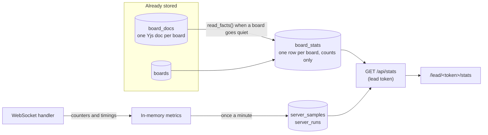

# Plan: a built-in stats page for operators

Status: plan only, nothing built · 2026-11-22 · checked against `main` at `9f76811`.

## Why

An operator of a fast-retro server can't answer basic questions about it today:

- How many retros actually happened this month, and how big were they?
- Do teams come back?
- How many people has the server held at once, how fast does it sync, and how much headroom is left?

Google Analytics (optional, `GA_MEASUREMENT_ID`) answers a different set of questions: where visitors come from, what device they use, and which buttons they click. It can't answer the ones above, for three reasons:

1. **It sees clicks, not retros.** The events in `frontend/src/lib/analytics.ts` cover feature use (`board_create`, `card_group`, `present`, `board_export`, …). Nothing records a person joining, a card, a vote or a retro ending, and adding those would mean sending far more to a third party.
2. **It undercounts.** The audience for a retro tool is largely engineers, and many of them block analytics scripts. The database has every board.
3. **It knows nothing about the server.** Connections, sync latency, memory and restarts never reach a browser tag.

The server already stores everything needed for the first two questions. Every board's full document is in `board_docs` and is never deleted, so the history goes back to the first board. The third needs a small amount of new instrumentation.

## What we're building

A **Stats** page in the host dashboard (`/lead/<token>/stats`), backed by one admin endpoint, showing:

- **Product:** retros opened, held and ended per week; people, cards and votes per retro; board types; how far retros get; which features are used; how many retros continue from a previous one.
- **Server:** live and peak connections, updates processed, how long the server takes to apply and store an update, dropped clients, restarts, memory and database size.

Plus a **load test** that produces capacity numbers the server can't learn from real traffic: how many boards and people one instance holds at a stated sync latency.



### Goals

- Answer the questions above from the server's own data, with no third party involved.
- Cover all history on day one by backfilling from stored boards.
- Cost nothing noticeable on the sync path.
- Return counts only. No board link, board name, card text or participant name appears in the endpoint's response or on the page, so the page is safe to screenshot.
- No new runtime dependencies, no new environment variables, no new services. It stays one binary and one SQLite file.

### Not in this plan

- Replacing GA. It keeps the jobs it's good at (see [What stays in Google Analytics](#what-stays-in-google-analytics)).
- A first-party event endpoint for browser clicks. That is rebuilding GA, and an unauthenticated write endpoint is a new thing to abuse.
- Per-person analytics of any kind.
- Alerts, and monitoring that the site is reachable from outside. The server can't observe its own outage; that needs an external check.
- Fixing the bottlenecks this makes visible. Each gets its own plan if the numbers call for it.

## What the code gives us today

| Need | What exists | Gap |
| --- | --- | --- |
| Every board ever opened | `board_docs` holds a compacted Yjs doc per board. Nothing deletes them. | The server only reads `label`, card count, phase and `anonymous` from a doc (`Doc::read_summary` in `src/sync.rs`). |
| When a board was created or ended | `boards.created_at`, `boards.ended_at` | A board opened by link without `POST /api/boards` has a doc but no `boards` row. `boards.last_active_at` is only written at creation. |
| Who took part | The doc's `names` map has an entry for everyone who joined with a name. Cards carry `authorId`, `votes` and comment authors (`frontend/src/lib/cardcodec.ts`). | `participants` only records signed-in users. Archives can't be used: they drop `names` for anonymous boards, which is the default. |
| Live connections | `room.clients` per room, listed by `GET /api/boards` | Nothing is kept over time. A deploy restarts the process and the numbers are gone. |
| Sync speed, errors, memory | Log lines only | No counters or timings. |
| A place for the page | Host dashboard at `/lead/<token>`, with endpoints gated by `check_lead_token` | No stats page. |
| An isolated server to test against | `./test-local.sh` (scratch port and database, `FASTRETRO_RATE_LIMIT` raised) | No load generator. |

I checked the "who took part" idea against a read-only copy of a real database by decoding every stored doc: `names` covered every card author and voter on all but one board, and counting distinct ids from `names`, authors, voters and commenters gave sensible sizes for boards known to be real retros. Archives alone would have reported one person for almost every board.

## Definitions

These need to be fixed before anything is built, because every number on the page depends on them.

| Term | Definition |
| --- | --- |
| **Board opened** | A board with a stored doc. |
| **People** | Distinct ids in the doc: keys of `names`, card `authorId`s, voters, comment authors and reaction users. An id is per browser (`localStorage`), so one person on two devices counts twice and a presenter's second window doesn't add one. |
| **Retro held** | A board with at least 2 people and at least 3 cards (decision S1). This is what filters out test boards and abandoned ones. Most headline numbers count held retros, not boards opened. |
| **Retro ended** | A held retro whose host pressed End (`boards.ended_at`). |
| **Final phase** | `phase.current` when the board was last active. It's where the retro stopped, not the furthest it ever reached. |
| **Board type** | `canvas` if `meta.layout` is `canvas`, `custom` if `meta.columns` is set, else `classic`. |
| **Continued retro** | `meta.importedKind` is `carryover`: the host started it with "next retro" from a previous one. This is the retention signal that needs no new tracking. |
| **Week** | Monday to Sunday in UTC, by the board's first-seen time. The page says so. |

## Design

### 1. Board facts

A new `Doc::read_facts()` next to `read_summary()` walks a doc and returns counts: columns, cards, votes, comments, groups, action items, people, plus phase, board type, the on/off settings and whether it's a continued retro. It reads only, never errors, and counts anything missing or malformed as zero.

Results are cached in a new table, one row per board:

```sql
CREATE TABLE IF NOT EXISTS board_stats (
    slug           TEXT PRIMARY KEY,
    first_seen_at  INTEGER NOT NULL,  -- boards.created_at when there is one
    last_active_at INTEGER NOT NULL,
    ended_at       INTEGER,
    board_type     TEXT NOT NULL,     -- classic | custom | canvas
    phase          TEXT NOT NULL,
    columns        INTEGER NOT NULL,
    people         INTEGER NOT NULL,
    cards          INTEGER NOT NULL,
    votes          INTEGER NOT NULL,
    comments       INTEGER NOT NULL,
    groups         INTEGER NOT NULL,
    action_items   INTEGER NOT NULL,
    anonymous      INTEGER NOT NULL,
    hide_cards     INTEGER NOT NULL,
    continued      INTEGER NOT NULL,
    signed_in_host INTEGER NOT NULL,
    peak_clients   INTEGER NOT NULL DEFAULT 0,
    facts_version  INTEGER NOT NULL
);
```

**When it's written.** `Room::compact()` already runs when the last person leaves, every 200 updates, and when a board ends. That is exactly when a board is quiet, so the facts are computed there and upserted. Nothing is added to the per-update path.

**Backfill.** On startup a background task finds stored docs with no `board_stats` row at the current `facts_version`, decodes each into a throwaway `Doc` (not a live room), and writes its row. One board at a time, yielding between boards, so startup isn't delayed. It runs once per board per version.

**It's a cache.** Everything except `peak_clients` and `last_active_at` can be recomputed from the docs. Changing a definition means bumping `facts_version`, and the backfill does the rest. No stored doc is ever modified.

**The cost of this design** is that the server now knows more about the board's shape. Until now it deliberately knew very little (the comment on `read_summary` says so). If the frontend changes how a card stores votes and the server isn't updated, stats go quietly wrong. Two guards:

- A contract test. A frontend unit test builds a board through `cardcodec.ts` and writes the encoded update to a fixture; a Rust test decodes that fixture and asserts the counts. Changing the card shape without updating `read_facts` fails CI.
- A line in `docs/RELEASING.md` under the existing `doc-model-change` rule: check `read_facts`.

The alternative, having the browser report counts as it does for archives, was rejected: it trusts the client, only fires when a host ends the board, and can't backfill.

### 2. Server metrics

A new `src/metrics.rs` holds a `Metrics` struct of atomics, shared by `AppState` and each `Room`:

| Metric | Where it's recorded |
| --- | --- |
| Connections now, peak, total opened | `handle_socket` on connect and disconnect |
| Messages and bytes received | `process_message` |
| Doc updates applied, awareness updates | `process_message` |
| **Apply time**: waiting for the doc lock plus applying the update | around `doc.apply_update_v1` |
| **Persist time**: waiting for the database lock plus the insert | around `Room::persist_update` |
| Clients dropped for falling behind | the `Lagged` branch of `forward_broadcasts` |
| Rejected updates, requests refused by the rate limiter | their existing error paths |
| Peak clients per board | `handle_socket`, written to `board_stats` at compaction |

Timings go into a fixed set of log-spaced buckets (about 16, from 50 µs to 5 s) of atomic counters. No histogram crate is needed. Recording one costs two clock reads and one atomic add.

**Persisting.** A background task wakes once a minute:

- It updates `last_seen_at` on this process's row in `server_runs (started_at, last_seen_at, version)`. That one table gives restarts, time between them, and how long the process has been up, without writing a row for every idle minute.
- If anything happened in that minute, it writes one row to `server_samples`: the connection and board gauges, counter deltas, memory (`/proc/self/statm` on Linux, null elsewhere), database size, and the **bucket counts** for both timings.

Bucket counts are stored rather than percentiles because percentiles can't be averaged. With the counts, p50/p95/p99 over any range is an exact merge.

Minute rows are kept for 90 days, then folded into `server_days` (one row per day: peaks, totals, merged buckets) which is kept. At one row per active minute this is a few megabytes at most (decision S5).

There is no shutdown hook today, so a restart loses at most the last minute of counters. That's acceptable.

### 3. Endpoint

`GET /api/stats?days=90` (also `30`, `365`, `all`).

- Gated by `check_lead_token`, like `GET /api/boards`, and behind the same rate-limit layer because it's another place to guess the token.
- `Cache-Control: no-store`.
- Returns aggregates only: totals, medians, weekly buckets, shares, and the server section. Medians are computed in Rust from the integer columns of `board_stats`; SQLite has no median, and the rows are small.
- A test creates a board, calls the endpoint, and asserts the response contains neither the slug nor the label.

### 4. Page

`/lead/<token>/stats`, linked from the host dashboard next to History and Archives. It follows the existing host pages for the token check, layout and dark mode.

```
Stats                                   [30 days] [90 days] [12 months] [All]

Now      12 people connected · 3 boards active · up 6 days · build abc1234

Retros
  Held  38        Ended  21 (55%)       Continued from a previous retro  9 (24%)
  People per retro   median 6 · largest 14
  Cards per retro    median 22          Votes per retro   median 31

  Per week        ▂▃▅▇▅▆█▆▇▅▆▇   held ■  ended ■        [Show as table]

  Board type      classic 61% · custom 29% · canvas 10%
  Stopped at      brainstorm 8% · group 5% · vote 3% · discuss 26% · actions 58%
  Used            groups 44% · action items 71% · names shown 35% · hidden cards 12%
  Hosts           signed in 40% · signed-in hosts with 2+ retros 7

Server
  Peak connections    41 (all time 63)      Most people on one board  14
  Updates processed   182,400               Busiest minute            1,310
  Apply     p50 0.1 ms · p95 0.4 ms · p99 1.2 ms
  Persist   p50 0.3 ms · p95 1.1 ms · p99 6.0 ms
  Dropped clients 0 · Rejected updates 0 · Restarts 11
  Memory 48 MB (peak 71 MB) · Database 12 MB
```

(Numbers are invented.)

Charts are small hand-written SVG components: one weekly bar chart and a sparkline. A chart library would be the largest thing in a bundle that is embedded in the binary, for two charts (decision S4). Every chart has a "Show as table" toggle so the numbers are reachable by keyboard and screen reader, and so they can be copied.

Empty states matter here, because a new server has nothing: each section says what it will show and when, not a row of zeros.

### 5. Load test

Real traffic tells you what the server has handled, not what it can handle. `scripts/loadtest/` is a TypeScript generator that uses the same `yjs` and `y-websocket` packages as the frontend, so it speaks exactly the protocol real clients do.

- **Runs only against a scratch server.** A `./loadtest-local.sh` wrapper mirrors `test-local.sh`: scratch port and database, rate limit raised, refuses deployed ports, and uses a release binary (`FASTRETRO_BIN`), because debug-build numbers mean nothing.
- **Scenario.** A board has P people. In brainstorm each adds a card every 10 to 20 seconds; in vote each casts about five votes. A separate profile adds one person dragging a card on a canvas board, which sends awareness updates on every frame and is the heaviest traffic the app produces.
- **What it measures.** End-to-end latency: the moment one client makes a change to the moment another client on the same board sees it. All clients live in one process, so this needs no timestamps in the doc.
- **Ramp.** Boards step up (1, 10, 50, 100, 250, …) until the target is missed: p95 end-to-end at or under 150 ms, no dropped clients, no errors (decision S6).
- **Output.** A JSON file and a short table: the largest boards × people that met the target, CPU and memory at that point, and the server's own timings from `/api/stats` as a cross-check.
- **Results** go in `docs/load-test.md` with the method, the machine's size and the caveat that generator and server shared it. A ten-second `--smoke` run goes in CI so the harness doesn't rot; the full run is manual.

Reading the code suggests where it will give first. These are guesses for the test to confirm or kill:

1. Every doc update does a synchronous SQLite insert through one shared `Mutex<Connection>` on the async runtime's threads (`Db`, `Room::persist_update`). All boards queue on that lock.
2. Each new connection is sent the full board state, encoded under the doc lock.
3. Canvas drags fan out to everyone on the board at frame rate.
4. The per-room broadcast channel holds 256 messages; a burst past that drops slow clients so they resync.

## Security and privacy

- **Nothing leaves the server.** No new outbound request, no third party.
- **No new identifiers and no per-person rows.** `board_stats` holds counts per board. Board slugs are already in the same database.
- **Admin only.** The endpoint needs the lead token, compared in constant time and rate limited.
- **Counts only in the response,** enforced by a test.
- **No user content in logs or metrics.** Counter names are fixed; nothing is labelled by board.
- **Prerequisite, separate PR:** the page-view call in `frontend/src/routes/+layout.svelte` sends the real path. Board and host-dashboard pages should send their route pattern (`/board/:slug`, `/lead/:token/stats`) instead, and the tag's page location should be overridden the same way. This plan adds a host page that will be opened often, so that goes first. Its test intercepts requests to Google's collect endpoint and asserts none contains the board slug or the lead token.
- **README.** A short "Stats" section says what is counted, that it stays local, and how it differs from the optional GA tag.

## What stays in Google Analytics

| Question | Where |
| --- | --- |
| Where visitors come from, device, country | GA |
| Home page view → `board_create` | GA |
| Client-only features: Present, export, guide views, feedback links | GA |
| Retros held, size, completion, continued retros, board types, groups, action items | Stats page |
| Connections, latency, restarts, memory, capacity | Stats page and load test |

One note for operators who use GA, which belongs in the README rather than in code: event parameters such as `template`, `format` and `action` only appear in GA reports after they're registered as custom dimensions in the GA admin.

## Pull requests

Sizes are estimates from reading the code, not from a prototype.

| PR | What | Rough size | Visible? |
| --- | --- | --- | --- |
| 0 | GA page views send route patterns, with the intercept test. Independent of the rest. | +80 | No |
| 1 | `read_facts`, `board_stats`, compaction hook, backfill, `GET /api/stats` (retros section), contract fixture, unit tests | +500 | No (API only) |
| 2 | Stats page with the Retros section, dashboard link, chart components, e2e test, README section | +450 | Yes |
| 3 | `metrics.rs`, timings, minute sampler, `server_runs` / `server_samples` / `server_days`, Server section on the page | +600 | Yes |
| 4 | Load generator, `loadtest-local.sh`, CI smoke run, `docs/load-test.md` with first results | +500 | No |

PR 1 and PR 2 answer the product questions and can ship without the rest. PR 3 before PR 4, so the load test can read the server's own timings.

### Tests

- **Rust unit:** `read_facts` on hand-built docs, including empty, malformed and canvas boards; the contract fixture; week bucketing and medians; bucket merge and percentile maths; backfill runs once and is safe to repeat; endpoint returns 403 without the token and never includes a slug or label.
- **e2e (`tests/stats.spec.ts`, via `./test-local.sh`):** two browsers hold a small retro and leave; the Stats page then shows one more retro held, with the right people and card counts. The suite shares one database per run, so it asserts changes, not totals.
- **Overhead:** PR 3 runs the PR 4 smoke profile before and after (or, since PR 4 comes later, a one-off script) and reports the difference in p95. The bar is no measurable change.

### Rollout

- All schema changes are new tables created with `IF NOT EXISTS`, the pattern `db.rs` already uses. An older binary ignores them, so rolling back a release is safe.
- The Yjs board shape doesn't change, so no `doc-model-change` label.
- PR 1 can go out a release ahead of PR 2. That gives the backfill time to finish and lets the numbers be checked through the API against a few boards the operator knows.
- Nothing to configure.

## Risks

| Risk | Mitigation |
| --- | --- |
| Stats drift when the board shape changes | Contract fixture in CI; note in the release checklist; `facts_version` to recompute |
| Instrumentation slows the sync path | Atomics only on the hot path; facts computed at compaction; measured before and after |
| Backfill on a server with many boards | One board at a time in the background; resumable; skipped once done |
| Numbers get read as more precise than they are | Definitions shown on the page (people are browsers, weeks are UTC, final phase is not furthest phase) |
| Tables grow | Minute rows only for active minutes, 90-day retention, daily rollup |
| Load-test numbers quoted without their conditions | `docs/load-test.md` always states machine size, build and scenario next to the result |

## Found along the way

Not part of this plan unless wanted:

- `boards.last_active_at` is only set at creation, so "My retros" (`list_boards_for_user`) is really ordered by creation time. PR 1's compaction hook could update it in the same statement.
- Boards opened by link without `POST /api/boards` never get a `boards` row. `board_stats` covers them; nothing else lists them.

## Decisions

| # | Question | Recommendation |
| --- | --- | --- |
| S1 | What counts as a retro held? | At least 2 people and 3 cards. Low enough to keep small teams, high enough to drop test boards. |
| S2 | Count people as distinct browser ids in the doc? | Yes. It needs no new tracking and covers all history. The page states the caveat. |
| S3 | Measure returning teams beyond continued retros and signed-in hosts, by storing a keyed hash of each browser id per board? | Not yet. It's the best answer to "do teams come back", but it adds a table that links people across boards. Revisit after PR 2 shows whether the two free signals are enough. |
| S4 | Hand-written SVG charts or a chart library? | Hand-written. Two simple charts don't justify the bundle weight. |
| S5 | How long to keep minute samples? | 90 days, then daily rollups kept indefinitely. |
| S6 | What is the load-test target? | p95 end-to-end at or under 150 ms with no dropped clients or errors. |
| S7 | Show any per-board rows (for example the ten largest retros)? | No. Counts only, so the page can be shared. The dashboard already lists live boards. |
| S8 | Also expose the server metrics in Prometheus text format? | Not now. It's a small addition later if someone runs a metrics stack; nothing here blocks it. |
