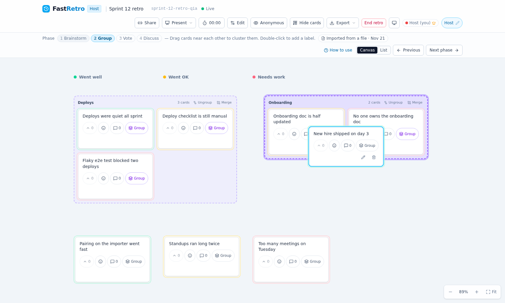

# Plan: "can't group cards" and "names weren't recorded" on a canvas board

Status: investigated, nothing built · 2026-11-21 · checked against `main` at `c9c5238` (the build on prod during the session and now)

Revised 2026-11-21 after Scott's review: the grouping fix is now **groups on the canvas itself**, not switching the board to columns. See [Groups on a canvas](#groups-on-a-canvas). A throwaway prototype was built to size it and then discarded.

## The report

Valentina ran a brainstorm on 2026-11-19 and reported two things:

1. She couldn't work out how to group cards any more, and wondered if grouping was broken.
2. The board didn't record people's names, even though they typed them in.

## Bottom line

Neither is a code regression, and no data was lost. Both come from how the board was set up, and the product gave her no way to see that or change it during the session.

| Symptom | Cause | Data |
| --- | --- | --- |
| Can't group | The board was created as a **Canvas**. A canvas has no groups by design, dropping a card on a card does nothing visible, and a board's type can't be changed after it's created. | All 32 cards intact. No groups exist because a canvas can't make any. |
| No names | Every new board starts **Anonymous**. The join screen asks for a name and never says it will be hidden on cards. | All six names are stored, including all four people who wrote cards. They're hidden, not missing. |

The names can be shown today by the host with one click (see [This board](#this-board)). Grouping needs the canvas groups work below, or a file export and import as a workaround.

## How I investigated

Nothing was changed on prod or QA. I took a read-only online backup of prod's database into a scratch directory, decoded the board's stored document from that copy, and ran the exact prod build (`c9c5238`, from `fast-retro-releases/prod`) on a scratch port against a second copy. Everything below was observed there. Prod's copy of the board has the same `updated_at` it had before I started.

## What the board looks like

| | |
| --- | --- |
| Created | 2026-11-12, by a signed-in host |
| Session | 2026-11-19 (a 5-minute timer was started 16:51 UTC) |
| Layout | `canvas`, with 6 prompts |
| Settings | Anonymous on, hide-cards on |
| Phase | Group |
| Cards | 32, from 4 authors. No votes, comments, groups or labels. |
| Moved cards | 6 of 32, each up or down within its own prompt's lane (2–17 px sideways) |
| Names stored | 6 |

The six moved cards are the telling part. Each ended up against a card in its own lane or level with one in the next lane. My reading is that someone was dropping cards onto related cards, which is how you group on a column board. On a canvas that only moves them.

For comparison, this is the only canvas board anyone outside testing has made. In the same two weeks, three column boards run by her colleagues grouped 21 of 35, 19 of 25 and 45 of 45 cards. So the team knew drag-to-group well, and "any more" in the report means "the way it worked on our other boards".

## Finding 1: grouping

Reproduced on the copy, as host, in the Group phase:

| Action | Result |
| --- | --- |
| Drop a card squarely on another card, Canvas view | The card moves and overlaps. No group, no merge, no message. The doc gains one position and nothing else. |
| Switch to List view | Looks exactly like a column board, but no card can be dragged and there's no Group button. The hint says "Switch to Canvas to arrange the cards." |
| Open Edit board | Name, prompts, Action items, Anonymous, hide-cards. Nothing about board type. |

This is the canvas working as designed (`docs/canvas-mode-plan.md`: "Nothing records membership", "Drop a card on a card: they overlap, and it never merges"). The design also deferred switching layouts (decision C3: "wait until someone asks"). The first version of this plan read the report as that ask. Scott's read is that the team wants groups on the canvas, which is what the moved cards suggest too, so that is now the fix.

Three things made it worse:

- **The first view is too small to read.** Fit shows every card, so on a 1500×950 window this board opens at **40% zoom**. Proximity grouping needs people to read the cards.
- **The only instruction is one line of grey text.** "Drag cards near each other to cluster them" sits in the phase bar. Nothing responds when someone tries the column gesture instead.
- **The first-run tips are about columns.** A new participant on a canvas is told to "Drag cards between columns".

The last release (#81–#83) didn't touch any canvas file, so this isn't a regression from it.

### Switching layout works on the copy (now the fallback)

Layout is one key in the board's `meta` map, and both surfaces already ignore what they don't use. On the copy I removed that key from a script while a host tab was open:

| Check | Result |
| --- | --- |
| The open tab | Switched to columns without a reload |
| Cards | All 32 present |
| Drag a card onto a card | Made a group of 2 |
| Set the key back to `canvas` | Canvas again, all 7 positions kept, and the group still stored |

So a switch needs no conversion, loses nothing in either direction, and reaches tabs that are already open.

## Finding 2: names

Reproduced on the copy:

| Check | Result |
| --- | --- |
| Join screen | "What should we call you?" and nothing about anonymity |
| Cards, as a participant | All 32 say "Anonymous" |
| Header | A small "Anonymous" badge |
| Host turns Anonymous off | All 32 cards show their author's name at once, for everyone |
| Warning to the host, or notice to participants | None |

Why the board was anonymous: `NewRetroModal` hard-codes `anonymous: true` (decision D7 in `docs/custom-columns-plan.md`), and the dialog has a checkbox for hide-cards but none for Anonymous. The host can turn it off from the toolbar afterwards, but nothing prompts her to, and she didn't know the names were there.

The mismatch is on the participant's side too. The board asks for a name, so people assume it will be used. The guide does explain it ("New boards start anonymous"), but nobody reads the guide before joining a meeting.

### Privacy: turning Anonymous off unmasks old cards silently

This is what rescues Valentina's board, and it's also a problem. People who wrote cards under an Anonymous badge can be named later by one click, with no confirmation for the host and no notice to them. The anonymity work below adds both.

Separately, and not changed by this plan: anonymity is a display setting. Every browser receives the author IDs and the names map, so anyone who opens dev tools can match them up. The guide's reference page already says it's "not a guarantee". Real anonymity would need the server to withhold authors, which is a much larger change.

## This board

Nobody but the host should change it, and nothing needs to be done to prod by hand.

- **Names:** Valentina opens the board and clicks **Anonymous** in the host toolbar. Names appear on every card. It's her call whether to tell the group first, since the board said Anonymous while they wrote.
- **Grouping, after canvas groups ship:** drop a card on a card, on the canvas, in the Group phase. The board is in Group already.
- **Grouping, today:** Export → Save board file, delete the `"layout": "canvas"` line, then Start a new retro → Import from file. I checked that the edited file parses as a 32-card column board with no warnings. It's a new board at a new link, and a file exported while Anonymous is on carries no names, so turn Anonymous off first if the names matter.

I'd wait for canvas groups unless she needs the board this week.

## Fix

Three pieces, each its own section below: groups on a canvas (the large one), canvas wording and first view, and visible anonymity. The last two are small and don't depend on the first.

## Groups on a canvas

**Bottom line: moderate, and smaller than it sounds.** Groups are already in the data on a canvas board. A card's group, the group's name, the board file, the CSV `group` column, archives and the host's archive viewer all work today whatever the layout. What's missing is the canvas drawing a group and its drag gestures, plus one new stored value: where the group sits.

| | Size |
| --- | --- |
| Throwaway prototype of the core (no tests) | +347 / −26 lines in 6 files |
| Estimate for the real thing, with tests (3 PRs) | About +1,900 to +2,400 lines |
| For scale | Group rows (#54–#59) were +3,446. Canvas mode (#62–#64, #66–#68) was +5,617. |
| Server | One optional field on archived groups. No SQL migration. |

The risk is in the design more than the code. A group box needs room on a board where nothing moves by itself, and dropping a card on a card starts to mean something on a surface built around nearness. Both are in [What's hard](#whats-hard).

### The prototype

*From the prototype, on made-up cards. A card is being dragged onto "Onboarding", which lights up before the drop.*

Built on a scratch copy of `main`, run against an empty scratch database on a scratch port, driven by two browsers, then deleted. Nothing here is on a branch.

| Check | Result |
| --- | --- |
| Drop a card on a loose card (Group phase) | A group of 2 appears where the target card was, for both people |
| Drop a card on a group | Joins it |
| Drag a card out of a group | Leaves it and stays where it was dropped |
| Drop on a group at 78% zoom, from the other browser | Joins it |
| Drag the whole group | Moves as one. The other person sees it move during the drag, and where it ends. |
| Name a group | Same header as a column board: name, card count, Ungroup, Merge |
| Group menu on a card (the keyboard and touch path) | Lists the groups and "New group…". Join and leave both work. |
| Ungroup | Every card stays exactly where it was drawn in the box (0 px moved) |
| Merge (host) | One card, at the group's corner, with the usual separator |
| Vote, then Discuss | The group shows "3 cards · 2 voters". A card can't be dragged out outside Group, as on columns. |
| Reload | Groups and their places are still there |
| Save board file | v4, `layout: canvas`, with the group and its three cards' membership. No file change was needed for that. |
| CSV | The `group` column is filled in. No change needed. |
| Browser errors | None |

Not checked: a real phone or touch screen, a 300-card board, a peer watching one card being dragged out of a group (only the end result was compared), hide-cards, Anonymous, and presenting.

### How it would work

- **A group is a box that holds its cards.** It has one position. The browser lays the cards out inside it, so the box always fits them, including a card with its comments open. The header is the existing `ClusterHeader`.
- **Membership is the existing field** (`card.clusterId`), with the existing rules: a card is in one group, grouping never changes its prompt or color, Action items can't be grouped, groups can only be changed in the Group phase, and Merge is host only.
- **Drop rules** go in one pure function with unit tests, like `planDrop` for columns: on a loose card makes a group, on a group joins it, anywhere else places the card and takes it out of its group.
- **New stored value: the group's position.** An optional `x`, `y` on the group's record in the `clusters` map. A group without one (made on a column board, in List view, or by an older file) sits where its first card is.
- **Cards keep their own position** while grouped. It's ignored until they leave.
- **Live movement reuses what's there.** A dragged group is one element, sent through the same awareness frames as a dragged card.

### Columns features on a canvas

Scott's bar: everything a column board can do with groups should be possible on a canvas.

| On a column board | On a canvas today | With this work |
| --- | --- | --- |
| Drop a card on a card to group them | They overlap | Prototyped |
| Drop a card on a group to add it | Nothing | Prototyped |
| Drag a card out to leave | Nothing | Prototyped |
| Group menu on each card | Not shown | Prototyped, same component |
| Group name, card count, voter count | Nothing | Prototyped, same component |
| Ungroup, Merge | Nothing | Prototyped |
| Groups hidden in Brainstorm, fixed outside Group | Nothing | Same rules. Brainstorm needs a decision (G8). |
| Everyone sees changes live | n/a | Prototyped |
| Board file, CSV, archive, archive viewer keep groups | Already do | Add the group's position to the file and the archive |
| Group rows in List view | Hidden on a canvas board | To build |
| Grouping on a phone | Not possible | To build: List view plus the card's Group menu |
| Groups ranked by voters in Discuss | Top voted lists cards only | To build: groups in Top voted |
| Move a card to another column | Not possible. A card keeps its prompt. | To build: a menu item on the card (G9) |
| Reorder cards in a column | Free placement replaces it | Not applicable |
| Cards re-sort by votes in Discuss | Cards never move by themselves | Not applicable (Top voted covers it) |

A canvas would also gain one thing columns don't have: moving a whole group at once.

### What's hard

1. **Room.** A group box is bigger than the card it replaces, and on a canvas nothing moves out of the way. In the prototype a new group covered its neighbors in the starting grid, a loose card left lying on a box looked like a member and blocked a click on the card under it, and "leave" from the menu put the card on top of the next group. Column boards don't have this problem because the grid reflows. This needs a rule (G6), and it needs trying on a real board.
2. **On a card, or near it.** The canvas exists because Valentina wanted nearness to be the grouping, "not the binary of grouped/not grouped". Now a drop *on* a card joins a group, and a drop *near* one doesn't. Someone who piles cards on purpose will make groups they didn't ask for. The prototype lights up the target before the drop, limits it to the Group phase, and dragging a card back out undoes it.
3. **A doc-model addition.** The group's position is a new optional value in the shared doc, so the PR carries the `doc-model-change` label. It's additive, and older builds ignore it. The record is last-writer-wins as a whole: a rename and a move of the same group made at the same moment keep one and drop the other (checked with two docs). Both people end up seeing the same thing.
4. **Brainstorm.** Groups are hidden in Brainstorm so a name can't hint at hidden cards. On a canvas, a host stepping back to Brainstorm would send grouped cards back to where they were before they were grouped (G8).
5. **Old tabs during a release.** A tab on the old build shows grouped cards at their earlier positions with no boxes. Nothing is lost, and a reload fixes it.
6. **Upkeep.** Groups would exist on two surfaces. Each later change to groups has to be made, and tested, twice.

Also found: the comment on `ColumnsSurface`'s `arrangeable` prop says moving a card in List view would lose its canvas position. It doesn't. `moveCard` keeps both position and group (checked). So List view can be allowed to group, and to move a card to another prompt, without harming the canvas.

### PRs

Stacked, each with unit tests and e2e, and each leaving the app working.

| PR | Branch | What ships | Seen by users? | Size |
| --- | --- | --- | --- | --- |
| A1 | `feat/canvas-groups-model` | The group's position: validated on read, writers, board file (optional field, no version bump), `src/archive.rs` with bounds, import and carry-over. Label: `doc-model-change`. | No | S–M, about +400 |
| A2 | `feat/canvas-groups` | The box on the canvas, the drop rules, drag in and out, moving a group, the card menu, Ungroup and Merge placement, stacking order, Fit, keyboard moves, hide-cards, analytics. Two-browser e2e. | Yes | L, about +1,000 to +1,300 |
| A3 | `feat/canvas-groups-parity` | Group rows and grouping in List view, groups in Top voted, move a card to another prompt, guide page and clip, QA script. | Yes | M, about +500 to +700 |

**Recommendation: build A1 and A2, put them on QA, and have Valentina try them on a practice board before A3.** The open questions are about feel (G5, G6), and a prototype screenshot won't settle them.

## Canvas wording and first view (was PR 2)

Still worth doing, and independent of groups.

- **First-run tips.** `Onboarding.svelte` gets canvas wording when the board is a canvas, in place of "Drag cards between columns".
- **Start a new retro.** The Canvas description says what it is: "Place cards anywhere. Drop a card on another to group them." (After A2. Until then: "No group rows.")
- **Group phase hint.** "Drag cards near each other, or drop one on another to group them. Double-click to add a label."
- **First view.** Don't open below a readable zoom. Fit to the board's width, start at the top, and never start under about 70%. The Fit button still shows everything. This one needs a look on a real 6-prompt board before settling the number.
- Tests: extend `canvas.spec.ts` for the first-view zoom, and `guide.spec.ts` if the wording there changes.

The note that explained why a drop on a card did nothing is dropped, since the drop will now group.

## Switching a board between columns and canvas (parked)

This was PR 1. It works (see Finding 1) and is small, but with groups on the canvas and group rows in List view it solves little. Parked until someone asks for it. If canvas groups are delayed, it's still the quickest way to unblock a board like this one.

## Anonymity that people can see and choose (was PR 3)

- **Creating.** `NewRetroModal` gets an **Anonymous** checkbox beside hide-cards, on by default (D7 stands, see N1). The creator now sees the choice instead of inheriting it.
- **Joining.** One line under the name field: "Your name shows in the list of who's here. On an anonymous board it's hidden on your cards." The prompt appears before the board connects, so it can't know the setting yet, which is why the line covers both cases.
- **Writing.** On an anonymous board, the composer shows "Posting anonymously" where people type. Own cards already say "you (hidden)".
- **Turning it off.** The host gets a confirmation that counts what will be revealed: "Show author names on 32 cards to everyone?" Every open tab then shows a notice: "The host turned off Anonymous. Names now show on cards." Turning it on needs neither.
- Tests: extend `anonymous.spec.ts` for the checkbox, the confirmation and the participant's notice.

## Decisions for Scott

| # | Question | Recommendation | Why |
| --- | --- | --- | --- |
| G1, G2 | Switching board type, and what happens to groups when switching | **Parked** | Superseded by groups on the canvas. See above. |
| G3 | Build the first-view zoom change? | **Yes, after trying it on a 6-prompt board** | 40% is unreadable, and it's the first thing a host sees. |
| G4 | What is a group on a canvas? | **A box that holds its cards,** with one position | An outline drawn around freely placed cards would also enclose cards that aren't members, and stretch when one is moved. A box contains exactly its members, moves as one, and reuses the column board's header. |
| G5 | Does dropping a card on a card make a group? | **Yes, in the Group phase only.** Near a card still only places it. | It's the gesture her team already uses on column boards, and what the six moved cards on this board look like. The target lights up first, and dragging back out undoes it. |
| G6 | How does a group get room? | **First version: it opens where the target card was, on top, and nothing else moves.** People drag the group to open space. Decide on anything automatic after QA. | Pushing other cards aside breaks the canvas rule that nothing moves by itself, and it's the costliest part to get right. Worth seeing whether people need it. |
| G7 | Group rows and grouping in List view on a canvas board? | **Yes** | It's the only way to group on a phone, and List view already draws group rows for column boards. |
| G8 | Groups in Brainstorm on a canvas? | **Keep the box, hide its name** | Hiding the box would make cards jump back to old positions. The name is the only part that could hint at hidden cards. |
| G9 | Add "move to another prompt" to a card on a canvas? | **Yes, in A3, as a menu item** | It's the one column-board action with no canvas equivalent, and `moveCard` already keeps position and group. |
| N1 | Should Custom and Canvas boards default to Anonymous off? | **Keep it on everywhere, but visible** | All 9 team sessions on prod since late October were left anonymous, and one confused session isn't enough to reverse D7. The checkbox fixes the surprise. Worth asking Valentina which she'd expect for a brainstorm. |
| N2 | Should turning Anonymous off reveal cards written while it was on? | **Yes, with the confirmation and the notice** | Revealing only later cards needs a per-card flag, which is a doc-model change, and it would stop a host recovering names in a case like this one. |

## Out of scope

- Moving other cards out of the way of a group automatically (G6, until QA says it's needed)
- Deriving groups from how close cards sit
- Selecting several loose cards and moving them together
- Switching a board between columns and canvas (parked)
- Server-side anonymity (withholding author IDs from other browsers)
- Changing this board's data from our side
