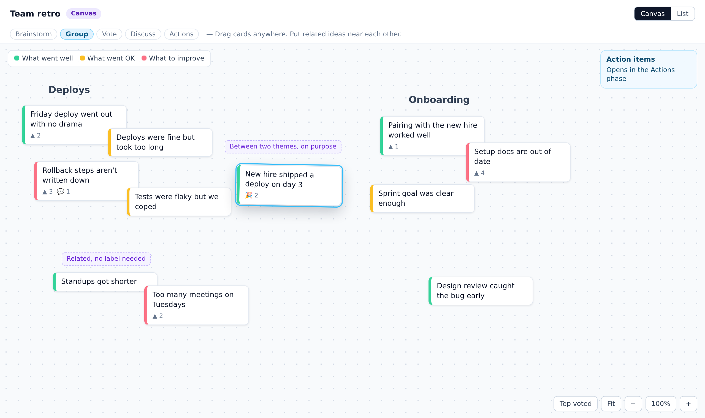

# Discovery: canvas mode

Status: discovery, five decisions open (see below) · 2026-11-04 · checked against `main` at `2e97998`, on top of `docs/card-groups-plan.md` (#52)

## Goal

Offer a free-form board as a separate kind of board, alongside columns. People place cards anywhere, and how close two cards sit is the grouping.

## Why

Valentina, after seeing the group rows mockup in #52:

> I think this works

> And you could add a separate "canvas mode" / As a separate top level function

> I like columns most of the time, but canvas mode can group in a more nuanced way, where the proximity maters, not the binary of "grouped/not grouped"

So this adds to group rows and doesn't replace them. Columns stay the default.

## Bottom line

**It's feasible with no new dependency, no SQL migration and only a small server change.** Cards stay in the existing per-column arrays and gain an optional position, so timer, phases, votes, comments, hide-cards, anonymity and export all keep working. Most of the new code is one rendering surface.

| | Size |
| --- | --- |
| Usable first version (PRs 1–5) | Estimated +3,000 to +4,000 lines including tests |
| Everything except the optional PR 8 (PRs 1–7) | Estimated at or above custom columns (#29–#36: +3,644 / −1,012 across 8 PRs). For comparison, Edit board (#37–#41) was +1,436 / −90. |
| Ongoing cost | A second surface. Every future card feature has to work on both. |

**Recommendation: ship group rows first, then build the canvas only up to PR 4 and put that preview in front of Valentina before committing to the rest.** We have one requester, who says she prefers columns most of the time, and prod boards are small (of 32 archives, the largest has 13 cards). PR 4 is a small enough bet to find out whether this is something teams would actually run a retro on.

## How Spreo (formerly Metro Retro) handles this

| Need | Spreo | Takeaway |
| --- | --- | --- |
| Placing cards | Double-click anywhere to create a sticky \[1\] | Copy it |
| Grouping | Named **Topics**: drag stickies toward one and they join it, and moving the topic moves them \[1\] | This is still grouped or not grouped. It's what Valentina is moving away from, so we don't copy it for now. |
| Regions | **Zones** own whatever sits fully inside them and can recolor stickies \[1\] | Not needed: a card's color comes from its prompt |
| Votes | Ranked results, by sticky or by topic \[2\] | A ranked panel replaces sort-by-votes |
| Private writing | Hidden from everyone but the author, including the host \[3\] | Same as our hide-cards |
| Moving around | Pan, zoom to 100%, zoom to fit \[4\] | Copy pan, zoom and fit |
| Shared attention | "Everyone To Me" and Spotlight for hosts \[4\] | Optional, PR 8 |
| Layout control | Lock the layout \[5\] | Later, if anyone asks |
| Export | CSV can include Zone and Topic columns, plus JSON \[6\] | Our board file keeps positions. CSV stays as it is. |

Spreo is a general whiteboard with shapes, connectors, drawing and templates. \[1\] We're not building that. This is a retro board whose cards can be placed freely.

## Proposal



*Static mockup, not the built UI. The dashed purple notes are annotations and wouldn't appear in the product.*

- **"Canvas" is a third choice in Start a new retro:** Retro, Custom, Canvas. It uses the same URL, sync, timer and phases.
- **Prompts replace columns.** A card keeps the color of the prompt it was written under, wherever it goes. That is Valentina's original ask: "went OK" and "went well" cards sit together and stay visibly different.
- **Nothing records membership.** There is no group object or boundary. In the mockup, "New hire shipped a deploy on day 3" sits between Deploys and Onboarding, which column rows can't express.
- **Labels float.** A label is text placed on the canvas, and it owns nothing. Moving a label doesn't move any cards.
- **List view is always available.** It renders the same cards in the existing columns, without dragging.

### How it behaves

| Action | Result |
| --- | --- |
| Drag a card | Moves it, and everyone sees it move live. The position saves on drop. |
| Drag empty space, or scroll | Pans |
| Pinch, or Ctrl/Cmd + scroll | Zooms around the pointer |
| **Fit** | Shows every card. Each person's view also starts this way. |
| Double-click empty space (Brainstorm) | New card at that spot, under the selected prompt |
| Composer at the bottom (Brainstorm) | New card under its prompt's heading, then pans there if it's off screen |
| Drop a card on a card | They overlap, and it never merges. The last moved card is on top. |
| Shift + arrows on a focused card | Nudges it, reusing today's move shortcut |
| Double-click empty space (Group onward) | New floating label |

**Starting layout.** Each prompt has a faint heading across the top, and a card nobody has moved sits in a grid under its heading. A new canvas therefore looks like columns without walls, and any board file imports without positions. A moved card leaves its grid slot empty, so the cards around it don't jump while someone is reaching for one.

**By phase:**

| Phase | On a canvas |
| --- | --- |
| Brainstorm | Add cards. With hide-cards on, others' cards are placeholders where they sit and can't be dragged. Labels are hidden, as in the group rows plan. |
| Group | Arrange and label. This phase's hint text changes. |
| Vote | Vote on cards. Nothing moves on its own. |
| Discuss | **Top voted** panel opens. Clicking a row pans to that card and highlights it. Cards never re-sort, so the auto-sort toggle is hidden. |
| Actions | Action items is a docked panel using the existing `BoardColumn`, outside the canvas. Carry-over keeps working. |
| Ended | Read-only. Pan, zoom and export still work. |

**What people give up on a canvas, compared with group rows:** Merge, a group's voter count, moving a theme as one unit (until PR 8), and any grouping in CSV. These are the costs of having no group object. A team that wants them can use a column board.

### Open decisions

| # | Question | Recommendation | Why |
| --- | --- | --- | --- |
| **C1** | Build it now? | **Group rows first, then PRs 1–4 as a preview, then decide** | Stops at a real test with little sunk cost. See Bottom line. |
| **C2** | Pure proximity, or also derive clusters? | **Pure proximity plus floating labels** | It's what she described. A distance threshold brings the binary back, and its boundaries would flicker during a drag. Deriving clusters later is cheap (0.38 ms at 300 cards), so nothing is ruled out. Worth confirming with her, since she knows Metro Retro's Topics. |
| **C3** | Can a board switch between columns and canvas? | **Chosen at creation.** People can still use List view. | Switching is cheap in the data, since it's one key and no conversion. The product question is what happens to group rows, so wait until someone asks. |
| **C4** | Who can move cards, and when? | **Anyone, in every phase, until the board ends** | This matches the existing rule that drag-to-reorder stays available in all phases (`phase.ts:63`). The risk is an accidental move during discussion with no undo. |
| **C5** | What do phones get? | **List view by default,** with a link to open the canvas | A free-form board is hard to use on a phone, and voting and comments work fine in the list. This also means phone users can't arrange cards unless they opt in. |

## Code design

### What's reusable

Cards live in `doc.getMap('board')` as one `Y.Array` per column, and live sync treats the doc as opaque. Keeping cards in those arrays means these need no redesign: `readAllCards`, votes, reactions, comments, `visibility.ts`, the server's card count, the timer, phases, `seedBoard`, the Edit board dialog and End retro. A column simply acts as a prompt.

A separate flat card store was rejected, since it would touch all of the above and gain nothing.

### Data model

```ts
// Board-level: absent means columns, so every existing board is unchanged.
meta.layout = 'canvas';

// CardData and the codec gain one optional field. Absent means "still in its
// starting grid slot". World coordinates, never screen pixels.
pos?: { x: number; y: number; z: number };

// New top-level map, only used on canvas boards.
doc.getMap('labels'): id → { text, x, y }
```

- **One `card.set('pos', …)` per drop.** It's a single last-writer-wins field and doesn't rebuild the card, so it avoids the duplicate-card race documented on `moveCard`. Canvas never calls `moveCard`, because a card doesn't change column.
- **`z` is the highest current `z` plus one** at drop time, so everyone agrees which card is on top. Ties break by card ID.
- **Reads are validated** in `cardcodec.ts`, as `sanitizeColumns` does for columns, because any client can write to the doc: finite numbers, clamped to a bounded world (±20,000), otherwise treated as unmoved.
- **No view state in the doc.** Each person's pan and zoom are local.
- **A canvas with no prompts** seeds one column titled "Notes", because `sanitizeColumns` falls back to the classic columns when given none.
- **Labels store no author,** so anonymous boards stay anonymous. They're capped at 200, 60 characters each.

### Modules

| Module | Job |
| --- | --- |
| `canvas.ts` | Pure and unit-tested, like `visibility.ts`: position validation, starting grid, screen and world conversion, zoom at a point, fit to bounds, next `z` |
| `CanvasSurface.svelte` | Viewport, world transform, gestures, headings, labels, zoom controls |
| `CanvasCard.svelte` | Positions a `Card`, handles pointer drag, shows peers' live drags |
| `CanvasComposer.svelte`, `TopVotedPanel.svelte`, `CanvasLabel.svelte` | As named |
| `ColumnsSurface.svelte` | Today's column rendering and about 160 lines of drag state, moved out of the 1,310-line `Board.svelte` |
| `yboard.ts` | New writers: `setCardPos`, `createLabel`, `moveLabel`, `editLabel`, `deleteLabel` |

`Board.svelte` keeps the connection, header, phases and end flow, then picks a surface. It hands both surfaces one `cardActions` object, not another 20 callback props, so the next card feature is added in one place.

`Card.svelte` gets a `surface` prop. On a canvas it turns off HTML5 drag (`:183`) and starts comments closed (`:75` opens them by default when a card has comments, which would make cards very tall). Comments still expand in place, and the active card is raised above its neighbors.

### Rendering: DOM with CSS transforms, no library

One world element gets `translate() scale()`, and each card is positioned inside it. That keeps `Card.svelte` with its comments, emoji picker, editing and focus handling.

| Rejected | Why |
| --- | --- |
| tldraw | React-based, and production use has required a license key since SDK 4.0 \[7\] |
| Excalidraw | MIT, but a React whiteboard with its own data model \[8\]\[9\] |
| `<canvas>` libraries (Konva, Fabric) | We'd have to rebuild everything `Card.svelte` already does, plus text input and accessibility, and the project prefers Svelte |

Dragging uses Pointer Events, not the HTML5 drag API. HTML5 drag doesn't work on most phones (noted in the group rows plan), and its drag image ignores the zoom.

### Live movement

Others see a drag through **Yjs awareness**, sent at about 20 Hz in world coordinates, which isn't persisted. The real position goes into the doc once, on drop.

### Measurements

From a throwaway spike with the repo's Yjs version, at 300 cards (the import limit). Scripts weren't committed.

| Question | Result | Conclusion |
| --- | --- | --- |
| Write position every frame? 200 two-second drags at 60 fps | 24,000 SQLite rows and 120 full-snapshot compactions (`COMPACT_THRESHOLD` is 200, `db.rs:93`) | **Never.** Commit on drop: 200 rows and 1 compaction. |
| Doc growth from commit on drop | 98.8 KB baseline → 106 KB after 300 moves → 148 KB after 5,000. About 40 B per update. | Fine. The WebSocket message limit is 2 MiB. |
| Update size compared with a `moveCard`-style rebuild | About 40 B against about 355 B | Position writes are about 9× smaller |
| Do separate `x` and `y` keys tear under concurrent drags? | 0 of 200 trials, for either shape | I expected tearing and didn't get it, so this isn't a correctness argument. One `pos` key is chosen only because it's simpler. |
| Re-read all cards | 0.13 ms | Fine. **This excludes Svelte re-rendering,** so PR 4 must measure that with the real `Card`. |
| Awareness during a drag | About 165 B per frame, 3.2 KB/s per dragger per peer | Fine for bandwidth, but see trap 1 |
| Pan, zoom and drag with 300 simplified cards (3,608 DOM nodes) | Steady 16.7 ms frames | **Weak evidence.** It shows the main thread keeps up, but headless Chromium on this box doesn't exercise paint or a GPU, and the cards are simpler than the real one. Needs a real phone and laptop in PR 4. |

## Traps

1. **A burst of messages can leave a client silently deaf. This bug exists today.** The loop forwarding broadcasts to a client is `while let Ok(msg) = bcast_rx.recv().await` (`main.rs:632`). Tokio's `recv` returns `Err(Lagged)` when a receiver falls more than the buffer behind, and the buffer is 256 messages shared by doc and awareness updates (`main.rs:71`). The loop then exits, but the socket stays open and the 15-second keepalive runs in its own task, so y-websocket doesn't see a reason to reconnect. That client stops seeing changes until it reloads. Found by reading the code, not reproduced. At 20 Hz, ten people dragging fill that buffer in 1.3 seconds if a task stalls. Fix: on `Lagged`, close the socket so the client reconnects and fully resyncs. PR 1.
2. **Drag traffic would re-render the whole board.** `aw.on('change', refreshPresence)` (`useBoardConnection.svelte.ts:176`) rebuilds `state.presence`, which recomputes `typingByCard` and flows into every card, 20 times a second. Put drags in their own awareness field and state, leave presence unchanged unless a presence field changed, and write peers' drag positions directly to the element's style.
3. **Silent loss of positions and layout.** `copyCards` and `parseBoardFile` in `boardfile.ts` and `CardSnapshot` in `src/archive.rs` list fields by name, the same trap as in the group rows plan. Also easy to miss: `carryOverFile` and `newBoardSeed` (`Board.svelte:901`, `:935`) would turn the next retro back into columns unless they pass `layout`.
4. **Ghost cards.** The server doesn't broadcast awareness removal (`main.rs:684`), and a dropped connection skips the client's own goodbye, so someone losing their connection mid-drag could leave a card hovering until the client timeout. Drop a peer's live position if no frame arrives for about a second, and fall back to the doc.
5. **A drop arriving during your own drag.** Your drag wins on screen until you let go, then last-writer-wins decides. Don't let an incoming update make the card jump mid-drag.
6. **Focus scrolls the viewport.** Tabbing to an off-screen card makes the browser scroll even an `overflow: hidden` container, which silently desyncs pan. Reset the container's scroll on focus and pan to the card instead.
7. **Blurry text.** `will-change: transform` rasterizes at the current scale, so set it on the world only during a gesture, and never on every card.
8. **Stacking.** Transforms create stacking contexts, so a card's emoji picker can open beneath the next card. Raise the active card's `z-index` locally.
9. **Non-passive listeners.** Stopping the browser's own zoom needs `preventDefault`, so attach `wheel` and touch listeners directly with `{ passive: false }`.
10. **Clicks versus drags.** Start a drag only after about 4 px of movement, and never from a button, input or link inside the card.
11. **Page layout.** `Board.svelte` is a scrolling page with a footer. The canvas needs a fixed-height viewport with `touch-action: none` only on the canvas, and no footer.
12. **Anonymity.** Never show who is dragging on an anonymous board, as `typingByCard` already does for typing. No live cursors in this version: even an unlabeled cursor shows which person just wrote which card.
13. **Stale tabs and rollback are safe but lossy.** An older build ignores `layout` and `pos` and shows columns. If it moves a card, it rebuilds the card without `pos`, so that card returns to its starting slot. No crash, and no data other than that position is lost.

## Persistence

| Where | Change |
| --- | --- |
| `boardfile.ts` | `board.layout`, `board.labels`, card `pos`, in `copyCards` and `parseBoardFile`. Label IDs regenerate on import, as card IDs do. |
| File version | Next free number, written **only for canvas boards**, because an older reader would silently lose the layout (the rule at the top of `boardfile.ts`). If group rows ship first, that's v4. Earlier frozen fixtures stay unchanged, plus a new frozen one. |
| `src/archive.rs` | `pos` on `CardSnapshot`, `layout` and `labels` on `ArchiveRequest` and `Archive`, with `skip_serializing_if`. Bound them in `validate()`. Old archives keep loading. |
| `Board.svelte`, `api.ts` | Send them from the end flow, and pass `layout` in carry-over |
| Host archive viewer | Renders the existing columns with a "Canvas" tag in this version. Its download keeps positions. The ended board itself still shows the canvas. |
| `csv.ts` | No change. Spreadsheets get the card and its prompt. |

No SQL migration. Everything is additive, so rolling back with `make rollback` is safe.

## Rollout

Stacked PRs off `main`, **after the group rows stack merges**, because its PR 1 reworks the same drag code that PR 2 here moves. PR 1 is the exception and can ship any time. Each PR passes `cargo test`, `cargo clippy --all-targets`, `bun run check`, unit tests and `./test-local.sh`, and leaves the app working.

| PR | Branch | What ships | User-visible? | Size |
| --- | --- | --- | --- | --- |
| 0 | `docs/canvas-mode-discovery` | This doc and the mockup | No | S |
| 1 | `fix/broadcast-lagged` | Trap 1, with a test. Worth doing regardless of canvas. | No | S |
| 2 | `refactor/board-surface` | `ColumnsSurface`, `cardActions`, `Card` `surface` prop. No behavior change, existing tests untouched. | No | M |
| 3 | `feat/canvas-model` | `layout`, card `pos`, `canvas.ts`, `setCardPos`, board file, archive, carry-over | No | M |
| 4 | `feat/canvas-surface` | Pan, zoom, fit, drag, live peer movement. No "Canvas" option yet, so a board is made by importing a file. **Preview for Valentina (C1).** | Preview only | L |
| 5 | `feat/canvas-authoring` | "Canvas" option, composer, double-click, headings, hide-cards, Action items dock, List view, phone default, docs page. **First real release.** | Yes | L |
| 6 | `feat/canvas-labels` | Floating labels, including persistence | Yes | M |
| 7 | `feat/canvas-discuss` | Top voted panel, Valentina's scenario end to end, QA script, analytics | Yes | S–M |
| 8 | Optional, decide from use | Select several cards and move them together, "Bring everyone here". Each is M. | Yes | M–L |

**Why this order:**

- Refactor first, so the canvas PRs add a surface without also changing column boards.
- Persistence before UI, so no real layout can be lost when a retro ends.
- PR 4 tests the idea with the least work, including the real-device check.
- Labels and Top voted are separate so either can be cut if the preview changes what's wanted.

**Release:** `make qa-deploy`, then `make prod-deploy`, per `docs/RELEASING.md`, with the `e2e` label on each PR. The QA service is private, so Valentina needs a preview tunnel for PR 4.

### Tests

**Unit (Vitest):**
- `canvas.ts`: position validation (NaN, strings, out of bounds), starting grid, a card leaving a gap without moving the others, zoom keeps the point under the pointer, fit, screen and world round trip at several zooms.
- CRDT with two docs (pattern in `boardedit.spec.ts`): concurrent drops converge, `z` ordering agrees, a concurrent move and comment both survive, removing a prompt removes its cards.
- Board file: round trip, frozen fixture, bad `pos` imports as unmoved, oversized labels, new label IDs, older files still load.

**Rust:** an archive with positions and labels round-trips, old archives load, `validate()` rejects oversized input, and a lagged receiver closes its socket.

**E2E (new `tests/canvas.spec.ts`, two browsers, `page.mouse` drives pointer events):**
- A drag appears live for the other person and survives a reload.
- Pan and zoom stay local, and a drop at 50% zoom lands in the right place for someone at 100%.
- Hide-cards shows placeholders that can't be dragged. Anonymous boards show no names during a drag.
- A card's prompt color is unchanged after moving it.
- Export and re-import restores positions and labels. Ending keeps them. Next retro stays a canvas.
- List view shows all cards with voting and no dragging. A phone-sized viewport starts there.
- A disconnect mid-drag leaves no ghost card.

**By hand, in the QA script:** a real iPhone and a mid-range laptop at 300 cards, because the spike couldn't exercise a GPU.

**Analytics:** `template: 'canvas'` on the existing board-creation event, plus `{ name: 'canvas_view'; params: { action: 'fit' | 'list' | 'top_voted' } }`, counts and enums only per `analytics.ts`. It tells us whether canvas boards get created and whether people retreat to List view.

## Out of scope

- Shapes, connectors, drawing, images, zones, frames, templates
- Live cursors, undo, a layout lock
- Named topics with membership, topic-level votes, auto-arranging
- Merge on a canvas
- Canvas rendering in the host archive viewer
- Switching an existing board between layouts (C3)

## Sources

1. Spreo Help, The Toolbar: https://docs.spreo.io/boards/the-tools
2. Spreo Help, Voting: https://docs.spreo.io/boards/voting
3. Spreo Help, Hide & Show Sticky Notes: https://docs.spreo.io/boards/hide-and-show-sticky-notes
4. Spreo Help, Keyboard Shortcuts: https://docs.spreo.io/help/keyboard-shortcuts
5. Spreo Help, docs index (Locking the layout): https://docs.spreo.io/llms.txt
6. Spreo Help, Export your board: https://docs.spreo.io/boards/export-your-board
7. Open-source tldraw alternatives in 2026 (license history): https://tryquickdraw.com/blog/open-source-tldraw-alternatives
8. Excalidraw vs tldraw: https://instapods.com/apps/excalidraw/vs/tldraw
9. Excalidraw vs tldraw vs Miro SDK: https://www.pkgpulse.com/guides/excalidraw-vs-tldraw-vs-miro-sdk-collaborative-2026
