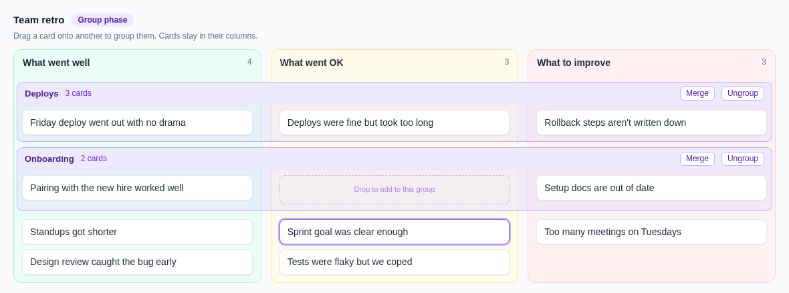

# Plan: group related cards across columns

Status: proposed, four decisions open (see below) · 2026-11-04 · checked against `main` at `2e97998`

## Goal

Let a team show that cards in different columns are about the same thing, while each card stays in its own column with its own text, votes, reactions and comments.

## Why

Valentina's feedback:

> One thing metro retro did which I liked was let you have clusters of ideas across different "columns", like if the same thing popped up as "went ok" and "went well", let's say, you could cluster them together but still keep them in separate columns

Today the only way to connect two cards is to drag one onto another in the Group phase (`mergeCards` in `frontend/src/lib/yboard.ts`). That deletes the source card, joins the text with `— — —`, moves it into the target's column, and can't be undone. It loses the exact thing she wants to keep: that one person said "went OK" and another said "went well".

How others handle it:

| Tool | Gesture | What happens to the cards | Who can do it |
| --- | --- | --- | --- |
| **Spreo** (formerly Metro Retro) | Drag stickies toward a named topic, or select them and choose "Group Under Topic" | Stay separate and move together as a topic. Drag one out to ungroup. \[1\] | Not stated in the docs read |
| **Retrium** | Drag notes together in a Group phase, then name the group | Stay separate, under a group title \[2\] | Everyone, by default \[2\] |
| **Parabol** | Drag into piles in a Group phase | Stay separate, with an editable group title \[3\] | Everyone at once \[3\] |
| **EasyRetro** | Drag one card onto another | Merged, with an unmerge option. It works across columns. \[4\] | Not stated in the docs read |

Spreo works on a free-form canvas, so its stickies physically gather in one place. Spreo can vote on stickies or on topics, and a topic's result includes votes on the stickies inside it. \[5\] fast-retro has fixed columns, so the design problem is showing "together" without leaving the column.

## Proposal

**Aligned group rows.** A group is a labeled row that runs across the columns. Each card sits in its own column, inside that row. Cards not in a group stay below the rows, as they do today.



*Static mockup, not the built UI. Merge is host-only, and the dashed drop hint shows only during a drag.*

This reads as "together" and "still in separate columns" at the same time. Colored badges on cards were the simpler alternative, but you'd have to scan the board to find a group's members, and a second color system would compete with the column colors. A separate "clusters view" would drop the columns she asked to keep.

The UI says **group**, which matches the Group phase. The code says **cluster**, because `group` already means the phase, the ARIA role on cards and a Tailwind class.

### How it behaves

**Rule 1: grouping never changes a card's column.** Dropping a card on a card or group row in another column adds it to the group, and it stays in its own column. To change a card's column, drag it to that column's ungrouped area or use Shift+arrow, as today.

| Action | Result |
| --- | --- |
| Drag a card onto the middle of a card | Group them. Joins the target's group if it has one. |
| Drag a card near a card's top or bottom edge | Reorder, shown with the existing blue line. (Today a merge target's whole body takes the drop, which makes reordering hard in Group.) |
| Drag a card onto a group row | Join that group |
| Drag a grouped card to the ungrouped area | Leave the group |
| Touch or keyboard: **Group** on the card | Menu of existing groups, **New group…** and **Remove from group**. HTML5 drag doesn't work on most phones, and keyboard users need a path too. |
| Click a group's name | Rename in place (like `ColumnTitle.svelte`). Unnamed groups show "Untitled group". Dropping a card never opens a text box, so grouping stays quick. |
| **Ungroup** | Cards go back to the ungrouped area. Nothing else changes. |
| **Merge** (host, with a confirm naming the target column) | The old merge, now explicit: "3 cards become one card in What went well." |

**By phase:**

| Phase | Behavior |
| --- | --- |
| Brainstorm | Shown flat. Coming back from Group keeps the groups but hides them, so a label can't hint at hidden cards. |
| Group | Groups can be created and edited only here. Rows stay in creation order so they don't jump around while people work. |
| Vote | Votes stay on cards. The row shows how many different people voted on any card in it. |
| Discuss, Actions | With auto-sort on, rows sort by that count and cards sort by votes inside each row. Dragging is already off while sorted. |
| Ended, archive | Rows shown read-only. |

**Known tradeoff:** rows always sit above ungrouped cards, so a top-voted ungrouped card can sit below a lower-voted group. Vote counts stay visible, and the host leads the order anyway.

**Small screens:** columns already stack. Each column shows its cards under a repeated group name, because there's no row to align to.

**Wide boards (5+ columns):** the board already scrolls sideways. The group name sticks to the left edge so it stays readable.

**No per-group colors, collapsing or group-level comments** in this version. Each adds UI without being needed for the request.

### Open decisions

These need your call. The rest of the plan assumes the recommendations.

| # | Question | Recommendation | Why |
| --- | --- | --- | --- |
| **D1** | Aligned rows, or just group blocks inside each column? | **Aligned rows** on desktop | It's the only option that shows both "together" and "separate columns". Worth confirming with Valentina using the mockup, because she's describing a canvas tool. If she only cares that cards keep their column identity, PR 5 can be dropped. |
| **D2** | What should dropping a card on a card do? | **Group**, and move Merge to the group row | The easy gesture should be the safe one. Only 3 cards were merged in 2 of the 32 archives on prod, so few habits break. That sample is small (only 3 archives have 5+ cards) and it can't show whether people want merge, so Merge stays. |
| **D3** | Who can group? | **Everyone in the Group phase.** Merge stays host-only. | Retrium and Parabol both do this. Merge is host-only because it's destructive, and grouping isn't. It's one `canCluster` derived value if you'd rather start host-only. The cost is that rows can shift while someone else is dragging. |
| **D4** | Can people vote on a group itself? | **No, only on cards**, with the row showing distinct voters | No schema change or second kind of vote. Counting distinct people stops a five-card group outranking a two-card group just for having more cards, and it matches how merge already unions votes. |

## Code design

### What's there today that matters

- Cards live in `doc.getMap('board')` as one `Y.Array` per column. `cardcodec.ts` is the only code that knows a card's layout.
- Live sync treats the doc as opaque, so the server needs no change for live boards. There are no server-side role checks on doc writes; lead-only actions are enforced in the client.
- Three copies of the card shape list fields by name and would **silently drop** a new one: `copyCards` and `parseBoardFile` in `boardfile.ts`, and `CardSnapshot` in `src/archive.rs` (serde ignores unknown fields). Without changes, ending a retro or exporting it would lose every group, with no error.
- Drag indexes are **render positions** passed to `moveCard` as array positions. That only works because cards render in array order today. Rows break that assumption.

### Data model

```ts
// New top-level map: doc.getMap('clusters'), id → { label, createdAt }
interface ClusterDef { id: string; label: string; createdAt: number }

// CardData and the codec gain one optional field
clusterId?: string;
```

**The card points at its group.** The group doesn't list its cards, for these reasons:

- A card can only ever be in one group, by construction.
- Deleting a card, merging it, or removing its column (`applyBoardEdit`) needs no group cleanup.
- Import regenerates card IDs (`seedBoard`), which would break a stored list of card IDs.
- `card.set('clusterId', …)` is a single last-writer-wins field. It doesn't rebuild the card, so it avoids the duplicate-card race documented on `moveCard`. That's what makes D3 safe.

**Nothing ever deletes a group record.** An empty group isn't shown and isn't exported. Deleting one could race with someone adding a card to it, and a stale `{label, createdAt}` costs almost nothing.

**A one-card group with no name displays as a normal card.** This is derived at read time, so dragging out the second-last card needs no write. A named one-card group stays visible, which is how **New group…** gives other cards something to join.

No group record stores who created it, so anonymous boards stay anonymous.

### One pure function for layout

New module `frontend/src/lib/clusters.ts`, following the `visibility.ts` pattern:

```ts
layoutBoard(columns, cards, clusters, { showClusters, sortByVotes }): {
  lanes: { cluster, cards: Record<columnKey, CardData[]>, count, voters }[];
  loose: Record<columnKey, CardData[]>;
}
```

All the rules live here and get unit tests: hidden in Brainstorm, missing or empty groups, one-card groups, sorting, the Action items column. `sortedByVotes` moves here from `Board.svelte`. It only computes display order and never writes to the doc, like today's sort.

Writers go in `yboard.ts` as one transaction each: `createCluster`, `setCardCluster`, `renameCluster`, `dissolveCluster`, `mergeCluster` (the existing `mergeCards` in a loop, then clearing the survivor's `clusterId`). `readClusters` validates what it reads, because any client can write to the doc, as `sanitizeColumns` does for columns.

**Action items can't be grouped.** It's the output of a retro, and it fills up after the Group phase. That column ignores rows and flows normally. It's always last (`sanitizeColumns`), so rows span only the input columns.

### Persistence

| Where | Change |
| --- | --- |
| `boardfile.ts` | `board.clusters: [{id, label}]` and `clusterId` on cards, in `copyCards` and `parseBoardFile`. Export only groups with cards. On import, new group IDs get mapped alongside card IDs. A `clusterId` with no matching group means the card imports ungrouped, with a warning. |
| File version | Write **v3 only for boards with groups**. The header comment says to bump when an older reader would silently lose data, and it would here. Other boards keep writing v1 or v2. The v1 and v2 frozen fixtures stay unchanged, plus a new frozen v3. |
| `src/archive.rs` | `cluster_id` on `CardSnapshot`, `clusters` on `ArchiveRequest` and `Archive`, with `skip_serializing_if`. Bound the count and label length in `validate()`. Old archives keep loading. |
| `Board.svelte`, `api.ts` | Send clusters from the end flow. Carry-over needs no change, since it copies only Action items. |
| `csv.ts` | Append a `group` column at the end so existing spreadsheet formulas keep working. Labels go through `csvCell`, so the formula-injection guard covers them. |
| Archive viewer | Use `layoutBoard` and show the stacked (small-screen) layout. No alignment in this version. |

No SQL migration. Everything is additive, so rolling back is safe: an older build ignores `clusterId` and shows a flat board.

### Traps to handle

1. **Drop position.** Change drops to "before card X" and look up X's array index at drop time. Do the same for Shift+Up/Down, and stop at a section's edge. This has to land before rows render, or reordering puts cards in the wrong place with no error.
2. **Drops between sections set `clusterId` only.** They don't call `moveCard`. Only a reorder within a section rebuilds the card, which keeps exposure to the `moveCard` race small.
3. **Layout: CSS subgrid.** Each `BoardColumn` stays one `<section>`, so its colored background runs the full height, and it spans all rows with `grid-template-rows: subgrid`. Group names sit in the parent grid. Subgrid has been in all major browsers since 2023, but it hasn't been tried in this app yet, so PR 5 starts by proving it. Fallback: the stacked layout, which is already shippable.
4. **Wide boards use implicit grid columns**, so `grid-column: 1 / -1` won't span them. Use `1 / span <input column count>`, with explicit column placement. `md:*:snap-start` also applies to every grid child.
5. **Remounts.** A card moving between row blocks is a different `{#each}`, so it remounts: an in-progress comment on that card is lost and it plays the fly-in, not the flip animation. Moving a card between columns already does this, so it's accepted.
6. **Roles.** Group blocks use `role="list"` with `aria-label="Group: Deploys, 3 cards"`, not `role="group"`. Existing tests count `role="group"` to find cards.
7. **Stale tabs after a deploy.** A tab on the old bundle drops `clusterId` when it moves a card, and its archive call drops groups. Tolerable: nothing crashes and only the grouping is lost.

### Scale

Prod boards are small: of 32 archives, the median has 1 card and the largest has 13. Import allows 300 cards, so test `layoutBoard` there, but it's a single pass over the cards and shouldn't need optimizing.

## Rollout

Stacked PRs off `main`. Each one passes `cargo test`, `cargo clippy --all-targets`, `bun run check`, unit tests and `./test-local.sh`, and leaves the app working.

| PR | Branch | What ships | User-visible? | Size |
| --- | --- | --- | --- | --- |
| 0 | `docs/card-groups-plan` | This doc and the mockup | No | S |
| 1 | `feat/clusters-model` | `clusters.ts`, codec field, `clusters` map, writers, drop-position fix (trap 1) | No | M |
| 2 | `feat/clusters-persist` | Board file v3, archive, CSV, end flow | No | M |
| 3 | `feat/clusters-ui` | Stacked group blocks, **Group** menu, rename, Ungroup, voter count. Merge drag unchanged. | Yes | M |
| 4 | `feat/clusters-drag` | Drag to group, edge reorder, Merge moves to the group row, copy and docs updates (D2) | Yes, changes a habit | M |
| 5 | `feat/clusters-lanes` | Aligned rows on desktop via subgrid, sorted rows in Discuss (D1) | Yes | M–L |
| 6 | `feat/clusters-scenario` | Valentina's scenario end to end, QA script, analytics | No | S |

**Why this order:**

- Persistence comes before any UI, so at no point can a real group be lost when a retro ends.
- PR 3 ships a complete feature that works on touch and keyboard before any layout risk.
- PR 4 is on its own so the gesture change can be reverted without losing the feature.
- PR 5 is the riskiest and most optional. If D1 goes the other way, or subgrid fails, stop at PR 4.

**Release:** deploy with `make qa-deploy`, then `make prod-deploy`, per `docs/RELEASING.md`. Add the `e2e` label to each PR so CI runs the full suite. A good checkpoint is to QA after PR 4 and again after PR 5. The QA service is private, so Valentina would need a preview tunnel or a prod release to try it.

### Tests

**Unit (Vitest):**
- `layoutBoard`: every rule above, including 300 cards.
- CRDT with two docs (pattern in `boardedit.spec.ts`): the same card grouped concurrently converges, concurrent group and rename, a card keeps its group through `moveCard`, removing a column leaves no broken group.
- Board file: round trip, frozen v3 fixture, unknown `clusterId`, oversized labels, new IDs on import, anonymous files carry no names.
- `mergeCluster`: votes, reactions and comments preserved.

**Rust:** an archive with groups round-trips, old archives load, `validate()` rejects oversized input.

**E2E (new `tests/card-groups.spec.ts`, two browsers):**
- Group across columns: both cards stay in their columns, and the other participant sees it live.
- Rename, leave, Ungroup, and a reload keeps it all.
- Menu path with no drag.
- Going back to Brainstorm with hide-cards on shows no group labels.
- Vote count counts people, not votes. Discuss sorts rows.
- Export and re-import restores groups. Ending shows them in the archive viewer.
- Merge from a group row (host only).

**Existing tests that change in PR 4,** because a drop now groups instead of merging: `tests/group-merge.spec.ts`, `tests/custom-columns.spec.ts:178`, `tests/brainstorm-scenario.spec.ts:208`, and `docs/qa-brainstorm-scenario.md:79`.

**Copy that changes in PR 4:** `PHASE_HINT.group` in `phase.ts`, the docs page (`routes/docs/+page.svelte:117`, `:226`, `:241`).

**Analytics:** `{ name: 'card_group'; params: { action: 'create' | 'join' | 'leave' | 'ungroup' | 'merge'; source: 'drag' | 'menu' } }`, counts and enums only, per the rule in `analytics.ts`. It tells us whether people use this, and whether Merge is still worth keeping.

## Out of scope

- Voting on a group itself, vote budgets, and turning a group into an action item
- Collapsing rows, per-group colors, comments on groups
- AI-suggested groups (Parabol, Spreo and EasyRetro all have some form of this) \[3\]\[4\]\[6\]
- Fixing the `moveCard` duplicate race, which is an existing limitation

## Sources

1. Spreo Help, The Toolbar (Topics): https://docs.spreo.io/boards/the-tools
2. Retrium Help, sticky note retrospective: https://support.retrium.com/articles/how-to-facilitate-a-sticky-note-retrospective-with-retrium
3. Parabol, Retrospective Meetings 101: https://www.parabol.co/resources/retrospective-meetings
4. EasyRetro, What's new: https://easyretro.io/whats-new
5. Spreo Help, Voting: https://docs.spreo.io/boards/voting
6. Spreo, Brainstorming software: https://spreo.io/solutions/team-collaboration/brainstorming
