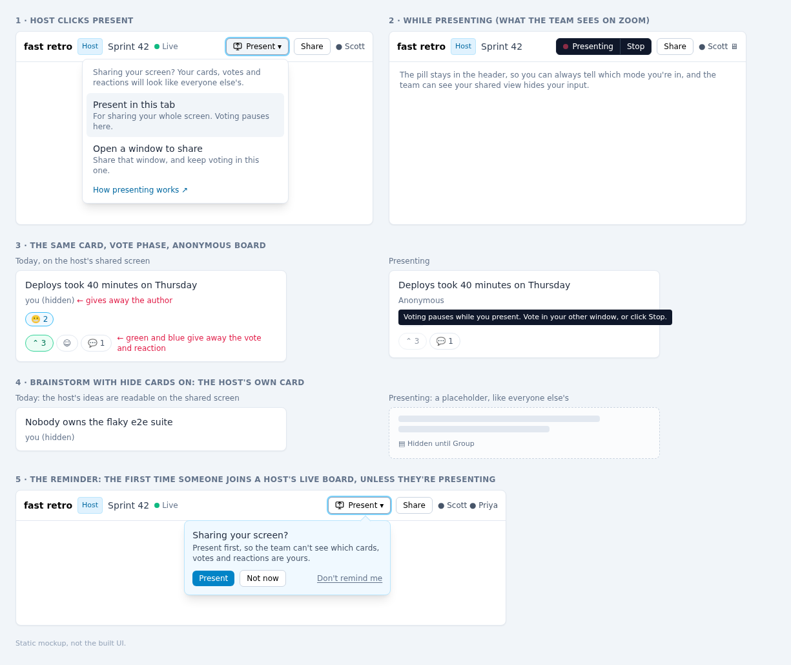

# Plan: present the board without giving away your own input

Status: plan, all decisions made (P1–P6). Ready to build, starting with PR 1 · checked against `main` at `7a0d3e6` · 2026-11-10

## Goal

A host who shares their screen on Zoom can show the board without showing which cards they wrote, which cards they voted on, or which reactions are theirs. Turning that on takes one click and is obvious at a glance, and the host can still facilitate.

## Why

On an anonymous board, the host's shared screen gives the host away. Everything below is visible to the whole call today:

| On the host's screen | Where | What it gives away |
| --- | --- | --- |
| `you (hidden)` under a card | `Card.svelte`, `isSelfAuthor` | That the host wrote it, on a board that's meant to be anonymous |
| A green, pressed vote button | `Card.svelte`, `hasVoted` | Every card the host voted for, while others are still voting |
| A blue reaction chip | `Card.svelte`, `users.includes(userId)` | The host's reactions |
| `Name (you, hidden)` on a comment | `Card.svelte`, `isSelfComment` | Which comments are the host's |
| The text of the host's own cards in Brainstorm with **Hide cards** on | `visibility.ts`, `isCardHidden` | The host's ideas, before the reveal. Everyone else's are placeholders, so the host's stand out. |

The last one undoes **Hide cards** for the host: the reason to hide cards is that people aren't swayed by others' ideas, and the host's are the ones most likely to sway.

Nothing else on the board marks the host's input. Edit and delete buttons appear on every card for a host, presence and the timer are shared, and Top voted and group rows show totals only. I checked every component that receives `userId`: `ColumnsSurface`, `BoardColumn`, `CanvasSurface`, `CanvasCard`, `CanvasDock` and `Card`.

### What others do

| Product | Name | How | Can the facilitator vote while presenting? |
| --- | --- | --- | --- |
| [TeamRetro](https://help.teamretro.com/article/444-anonymous-screen-share-view) | Anonymous screen share view | Opens **a separate window** to share. It "will not highlight your individual submissions and will hide the other facilitator functions". Their [Vote docs](https://help.teamretro.com/article/162-retrospective-vote-step) tell facilitators to use it. | Yes, in the original window |
| [EasyRetro](https://easyretro.io/whats-new) | Presentation mode | A **toggle** in the sidebar, Ctrl+P, "if you need to run a presentation and want to hide your votes" | Not documented |
| [Kollabe](https://kollabe.com/product-updates/screen-sharing-mode) (planning poker) | Screen Sharing Mode | A **toggle** in the user menu. Hides your votes, and you vote with the keyboard. | Yes, by keyboard |

Two shapes, then: toggle the tab you're in, or open a second window to share. They suit different ways of sharing. A toggle is what works when you share your whole screen, and a second window is what lets you keep voting privately. This plan offers both, and the second costs almost nothing once the first is built (see *State lives in the URL*).

## Proposal

**One rule: presenting shows the board the way another participant sees it.** Nothing on screen is marked as yours. That one sentence is the UX, the guide text and the code invariant, and it settles edge cases without new rules: your own hidden card is a placeholder because it's a placeholder to everyone else.



*Static mockup, not the built UI. Panel 5 is the reminder.*

### The button

A **Present** button in the header, beside **Share**, for the host. It opens a short menu:

- **Present in this tab**: for sharing your whole screen. Voting pauses here.
- **Open a window to share**: opens this board in a new window that's presenting. Share that window, and keep voting in this one.
- **How presenting works ↗**: opens `/docs/run#present` in a new tab.

While a tab is presenting, the button becomes a dark **● Presenting | Stop** pill. One click on **Stop** ends it. The pill uses a red dot because that already reads as "on air", and no other header element uses dark fill, so it doesn't look like the board settings (violet Anonymous, amber Hide cards, sky Auto-sort).

**It sits beside Share, not with the board settings in `LeadControls`.** Those toggles change the board for everyone. Presenting changes only this screen, and putting it among them would suggest it hides the host's input from the team's own screens too, which it can't.

The pill is also visible to the team on the shared screen. That's a feature: it tells them the host's input isn't being shown.

### The reminder

The likeliest way this goes wrong is that the host forgets to click **Present**. So hosts get a reminder (P4).

**When.** The first time someone else joins the host's live board while the host isn't presenting. A browser can't tell that Zoom is sharing it, so this is the next best thing: people arriving means the call has started, and that's usually before anything gets voted on. If someone's already there when the host opens the board, it shows right away. "Someone else" means a client with a different name and color, the same match the presence fold uses, so the host's own second window doesn't trigger it.

**What.** A callout anchored under the **Present** button (panel 5 in the mockup):

> **Sharing your screen?** Present first, so the team can't see which cards, votes and reactions are yours.
> **[Present]** **[Not now]** · *Don't remind me*

- **Present** opens the Present menu, so both options stay in one place and the host learns where the button is.
- **Not now**, Escape or the close button dismiss it for this board.
- **Don't remind me** turns it off in this browser. The Present menu gets a **Remind me when people join** checkbox, so it can be turned back on, and the setting lives in one place.

**When it never shows.** To participants, on ended boards, in a tab that's already presenting, on narrow screens where Present is in the mobile menu, and on a board where the host has already dismissed it or presented once.

**How it behaves.** It doesn't take focus or block anything, since the host may be typing. Screen readers announce it once through a polite live region. It goes away by itself when the host starts presenting from anywhere. It reveals nothing about the host's input, so it's fine if it shows up on a shared screen.

**Why it doesn't nag.** It shows once per board, only to the host, only when people are actually there. Hosts who never share their screen (everyone on their own laptop in the room) get one click to turn it off for good.

### What changes while presenting

| | Normal | Presenting |
| --- | --- | --- |
| Your card's author line | `you` / `you (hidden)` | What others see: `Anonymous`, or your name on a named board |
| Your comments | `Name (you, hidden)` | `Anonymous`, or your name |
| Vote button | Green and pressed if you voted | Neutral, with the count. **Disabled**, with the tooltip *Voting pauses while you present. Vote in your other window, or click Stop.* |
| Reaction chips | Blue if one is yours | Neutral, with counts. Not clickable, and the add-reaction button is hidden, as on an ended board. |
| Your cards in Brainstorm with Hide cards on | Full text | **Placeholder**, like everyone else's. Action items still show, as they do for everyone. |
| Adding cards and comments | Works | **Still works.** Hosts type action items and notes live, and that's content meant for the team. |
| Host controls (phases, timer, Edit board, groups, merge, End retro) | Work | **Still work** |
| Your board, everyone else's screens | | **Unchanged.** Presenting writes nothing to the board. |

**Why votes and reactions pause but cards and comments don't.** A vote or reaction is a private choice about someone else's card, and on a shared screen the click itself gives it away: the cursor lands on the card and its count goes up. A card or comment is something you're deliberately putting in front of the team. If votes stayed clickable but unmarked, the host couldn't tell whether they'd voted, and a second click would quietly remove the vote.

**Cards you add while presenting.** In Brainstorm with Hide cards on, a card the host adds turns into a placeholder as soon as it's added. The text was on screen while it was typed, though, and nothing can hide typing. The guide says to add your own Brainstorm cards in your other window, or before you share.

### Presence

**Open a window to share** gives the host two clients with the same name, and `disambiguateNames` would show everyone `Scott` and `Scott (2)` every retro. So:

- A presenting tab adds `presenting: true` to its awareness state.
- The presence list folds a presenting client into a non-presenting one with the same name and color (color is seeded from `userId`, so the same browser always matches), and shows a small screen icon on that person.
- A host presenting in a single tab just gets the icon.

The result is always one **Scott** with a screen icon, and the team can see that the shared screen is in presenting mode.

### Phones

The menu item goes in the mobile header menu too, for consistency, but nobody screen-shares a retro from a phone, so it isn't tuned for one.

## Decisions

All six decided by Scott on 2026-11-10: P4 changed from the original recommendation, the rest as recommended. Each is cheap to reverse.

| # | Question | Decision | Why |
| --- | --- | --- | --- |
| **P1** | Who gets the button? | **Hosts**, including on ended boards | It's the host's problem. Ended boards count because hosts share last retro's board to review action items, and their votes are still highlighted there. The code doesn't depend on role, so offering it to everyone later means changing one condition. |
| **P2** | Votes and reactions while presenting in the same tab | **Paused**, with a tooltip saying where to vote | See *Why votes and reactions pause*. Kollabe's keyboard voting is the alternative, but keyboard voting with invisible state has the same "did I vote?" problem. |
| **P3** | Offer **Open a window to share**? | **Yes**, in its own PR | It's TeamRetro's model, and the only way to vote privately while presenting from one computer. It's a `window.open` plus the presence fold. |
| **P4** | Remind hosts to present? | **Yes, in v1.** See *The reminder*. | Scott, 2026-11-10. Forgetting to click is the most likely way presenting fails, and the reminder shows once per board, with a way to turn it off. |
| **P5** | What the UI calls it | **Present** / **Presenting**. The guide section is *Present while you share your screen*. | It's a verb on a button and says what you're about to do. "Presenter mode" reads as a board setting. |
| **P6** | Hide host controls while presenting, as TeamRetro's window does? | **No** | They don't reveal anything about the host's input, and the host may drive from the presenting tab. A cleaner audience view is a separate feature. |

## Code design

### What's there today

- `Card.svelte` uses its `userId` prop for one job: deciding what on the card is "yours" (author line, vote and reaction state, comment names, `canEdit`). It never acts as that user, because actions go through the `cardActions` closure that `Board.svelte` builds with the real `userId`.
- `ColumnsSurface`, `BoardColumn`, `CanvasSurface`, `CanvasCard` and `CanvasDock` receive `userId` only to pass to `Card` or to `isCardHidden`.
- `isCardHidden` in `visibility.ts` compares `card.authorId` with `ctx.userId`.
- So below `Board.svelte`, `userId` already means "who this screen is drawn for", not "who's acting". It's just typed as a plain string, so nothing can express "nobody".

That makes this mostly a matter of naming what's already there, plus a small new state.

### A viewer, separate from the actor

New module `frontend/src/lib/viewer.ts`, in the style of `visibility.ts`:

```ts
// Who the screen is drawn for. Actions always use the real user id; a viewer
// only decides what's marked as yours. While presenting, nothing is, so the
// board looks the way it does to anyone else.
export type Viewer = { kind: 'self'; id: string } | { kind: 'presenting' };

export function isMine(viewer: Viewer, authorId: string): boolean;              // false when presenting or authorId is empty
export function includesMine(viewer: Viewer, userIds: readonly string[]): boolean;
```

Then the `userId` prop becomes `viewer: Viewer` from `Board.svelte` down: `ColumnsSurface`, `BoardColumn`, `CanvasSurface`, `CanvasCard`, `CanvasDock`, `Card`. `VisibilityContext.userId` becomes `viewer`. Because the type changes, `svelte-check` fails on any component still comparing against a bare id, so nothing that marks your input can be missed.

In `Card.svelte`, the five self checks become `isMine` / `includesMine`. `resolveDisplayName` takes `selfId: string | null`. `canEdit` becomes `isLead || isMine(viewer, card.authorId)`, which leaves hosts unchanged.

A discriminated union beats `viewerId: string | null` because `null` would silently mean "presenting" in a dozen places. A `presenting` boolean passed alongside `userId` would let the two disagree.

### State lives in the URL

Presenting is `?present` on the board URL. It's the only place the state is stored.

- **Per tab, and survives a reload.** A host who reloads mid-call is still presenting.
- **The second window is just a link.** **Open a window to share** is `window.open(withPresenting(url, true), 'fast-retro-present', 'popup')`. The named target means a second click reuses that window instead of opening another. The original tab has no `?present`, so it stays private.
- **Nothing to clean up.** It isn't written to localStorage, the board, or the server.
- **Share is unaffected.** `copyBoardLink` already builds `/board/<slug>` from scratch and drops the query.

`sessionStorage` was the alternative. It's per tab too, but whether a new window inherits it depends on the browser and on `noopener`, and "Open a window to share" depends on exactly that.

`viewer.ts` also owns `isPresentingUrl(url)` and `withPresenting(url, on)`. `Board.svelte` derives `viewer` from `page.url` and toggles with `goto(withPresenting(page.url, on), { replaceState: true, keepFocus: true, noScroll: true })`, so toggling doesn't add history entries. Only the `{#key slug}` in the route remounts the board, so a query change doesn't reconnect.

### Components

| File | Change |
| --- | --- |
| `lib/viewer.ts` (new) | `Viewer`, `isMine`, `includesMine`, URL helpers |
| `lib/PresentButton.svelte` (new) | The button, menu and Presenting pill. Props: `presenting`, `onPresent`, `onOpenWindow`, `onStop`. Same popover and Escape handling as the timer popover in `LeadControls`. |
| `Board.svelte` | Derives `viewer`, passes it down in place of `userId`, toggles the URL, publishes `presenting` in awareness |
| `BoardHeader.svelte` | Renders `PresentButton` for hosts, desktop and mobile menu |
| `Card.svelte` | `isMine` / `includesMine`. Vote and reactions disabled while presenting, with their own label and tooltip. |
| `visibility.ts` | Takes a `Viewer`. Comment updated: presenting hides your own cards too. |
| `identity.ts` | `selfId: string \| null` |
| `types.ts`, `awareness.ts`, `useBoardConnection.svelte.ts` | `presenting` on `AwarenessUser` and `PresenceUser`, read in `refreshPresence`. `samePresence` compares it too, or toggling wouldn't reach the list. |
| `identity.ts`, `PresenceList.svelte` | A pure `foldPresenting(presence)` beside `disambiguateNames`, run before it in `Board.svelte`, plus the screen icon |
| `identity.ts` | `isSamePerson(a, b)` (same name and color). The reminder uses it to ignore the host's own clients, and `foldPresenting` reuses it. |
| `lib/presentReminder.ts` (new) | Pure `shouldRemind({ isLead, ended, presenting, narrow, othersHere, dismissedHere, remindersOff })`, so every rule in *When it never shows* is a unit test, not an `{#if}` |
| `storage.ts` | `retro-present-reminders` on/off flag, plus dismissed board slugs. The list keeps the 50 most recent, like recent boards in `boards.ts`. |
| `PresentButton.svelte` | Renders the callout when `shouldRemind` says so, and the **Remind me when people join** checkbox in the menu |
| `analytics.ts` | `{ name: 'present'; params: { action: 'tab' \| 'window' \| 'stop' } }` and `{ name: 'present_reminder'; params: { action: 'shown' \| 'present' \| 'not_now' \| 'off' } }`. Fixed enums only, as the file requires. Together they show whether the reminder leads to presenting. |

No server, schema, board file, CSV or archive change. Presenting never touches the Y.Doc.

## Tests

**Unit**
- `viewer.spec.ts`: `isMine` and `includesMine` for self, presenting, and empty `authorId`. URL helpers round-trip and leave other params alone.
- `visibility.spec.ts`: presenting hides your own card in Brainstorm with Hide cards on. Action items and ended boards are never hidden. Without Hide cards nothing is hidden.
- `presentReminder.spec.ts`: shows for a host on a live board once someone else is here; never for participants, ended boards, a presenting tab, narrow screens, a board already dismissed or presented on, or with reminders off; the host's own second window doesn't count as someone else.
- New `identity.spec.ts` for `foldPresenting`: folds a matching pair, leaves an unmatched presenting client with its icon, and never folds two different people who share a name but not a color.

**E2E**, `tests/presenter-mode.spec.ts`, run through `./test-local.sh` as usual. A host page and a participant page, on an anonymous board.
- Host adds a card, votes, reacts and comments, then presents. No `you`, vote button not `aria-pressed` and disabled with the presenting label, reaction chip not pressed, comment shows `Anonymous`.
- Brainstorm with Hide cards on: the host's card is a placeholder, and an action item isn't.
- Reload keeps presenting. **Stop** restores everything. **Share** copies a link without `?present`.
- Reminder: a host alone on the board sees no reminder. It appears when the participant joins. **Not now** hides it, and it stays hidden after a reload. **Present** opens the menu. **Don't remind me** keeps it off on a new board, and the menu checkbox turns it back on. The participant never sees it.
- **Open a window to share**: the popup has `?present`, the opener doesn't, and the participant sees one host with the screen icon.
- Canvas board: the host's hidden card is a placeholder in both Canvas and List view.
- The participant's page is unchanged throughout. A regression here would mean presenting leaked into the board.

## Guide and docs

Each PR updates the guide for the behavior it ships, per `tests/README.md`.

| Where | Change |
| --- | --- |
| `/docs/run` | New section **Present while you share your screen**, with `id="present"` for the menu's link, between *Start and share* and *Walk through the phases*. Covers: click **Present** before you share; which option fits which way of sharing; what changes on your screen, and that nobody else's screen changes; voting pauses, so vote in your other window or on your phone; what you type is still on screen, so add your own Brainstorm cards elsewhere; **Stop**; the reminder when people join, and the **Remind me when people join** checkbox to turn it back on. Plus a `present` clip. |
| `/docs/brainstorm` | A *Good to know* line: sharing your screen during Brainstorm shows your own ideas unless you present. Links to `/docs/run#present`. |
| `/docs/reference` | *Who can do what*: a row for **Present** (Any phase, Host). *Privacy*: "Presenting changes only your screen. The board and everyone else's view are unchanged." *Admin links*: the lead link has the token in the address bar, so share a tab rather than a whole screen or window when using it. |
| `lib/guide/pages.ts` | The `run` summary becomes "Start a board, share it, present it, and walk your team through the phases." |
| `tests/guide-clips/present.clip.ts` | New clip, under 10 seconds: a host's card with their vote highlighted, click **Present** → **Present in this tab**, and the highlights go. Same recipe and size limits as the other clips. |
| `README.md` | Feature list: **Presenting**: share your screen without showing your own cards, votes or reactions. |

**The admin-link leak.** It's real but narrow. Hosts who start a board from the homepage use `/board/<slug>` with a host key in localStorage, so their address bar shows nothing secret. Only the server owner's `/lead/<token>/…` route puts the server-wide token on screen, and anyone who reads it can take over every board. Presenting can't hide an address bar, so this plan only documents it. Moving the token out of the path is its own change.

## Rollout

Stacked PRs off `main`. Each passes the usual gates (`cargo test`, `cargo clippy --all-targets`, `bun run check`, unit tests, `./test-local.sh`) and ships the normal way: QA first, then prod once QA holds `main`'s build (`docs/RELEASING.md`).

| PR | Scope | Useful alone? |
| --- | --- | --- |
| 0 | This plan and the mockup | |
| 1 | **Refactor, no behavior change.** `viewer.ts` with `isMine`/`includesMine`, `userId` → `viewer` down the tree, `visibility.ts` and `identity.ts` take it. The viewer is always `self`, so every existing test passes unchanged. | Yes: names a concept the code already had, so PR 2 is small and easy to review |
| 2 | **Present in this tab.** URL state, `PresentButton` with the in-tab option and **How presenting works**, the pill, paused votes and reactions, the `present` event, unit and e2e tests, the `/docs/run` section and the other guide text | Yes: covers the common case, sharing a whole screen |
| 3 | **The reminder.** `presentReminder.ts`, `isSamePerson` in `identity.ts`, storage, the callout and menu checkbox, the `present_reminder` event, unit and e2e tests, guide text | Yes: makes PR 2 hard to forget |
| 4 | **Open a window to share.** The menu item, `presenting` in awareness, `foldPresenting` and the icon, e2e for the popup and presence, guide text for the second option | Yes |
| 5 | `present` clip and README | Yes |

PR 1 is the one to review carefully: it touches the most files, and a missed rename there would be an invisible bug later. The type change is what makes it safe, since `svelte-check` finds every site.

**Done when** a host can share their whole screen in an anonymous Vote phase and nobody on the call can tell which cards they wrote, voted for or reacted to; when Brainstorm with Hide cards on shows the host's ideas as placeholders on the shared screen; when the host can still vote privately from a second window; and when a host who forgets to present gets reminded as soon as people arrive.

## Not in this plan

- **A keyboard shortcut.** EasyRetro uses Ctrl+P, which is the browser's Print. Revisit if hosts ask.
- **An audience view without host controls** (P6).
- **Hiding what you type.** Not possible. The guide covers it.
- **Moving the lead token out of the URL.** See *The admin-link leak*.
- **Presenting for participants** (P1). It's one condition when wanted.
- **Detecting screen sharing.** Browsers can't see what Zoom shares, so the reminder goes by people joining instead.
