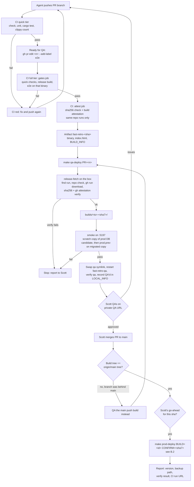
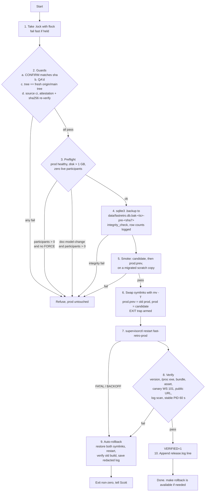

# Release tooling plan: QA and prod for fast-retro

Status: **accepted (Q1–Q5), revised after SRE review on PR #42, then for CI-built artifacts (Q5)** · 2026-11-04 · author: Claude (SRE view)

Goal: one scripted, repeatable path for an agent to ship fast-retro to **QA** and then **prod**. Each step should be safe to rerun, roll back in one command, and leave an audit trail. Agents should follow a runbook instead of rebuilding the process from chat history each time.

This doc is written for the agent that implements it. Read "Current state" first; the design is shaped by what went wrong on 2026-11-02 and 2026-11-03. Appendix A maps every review comment on PR #42 to the section that addresses it.

**In one line:** GitHub Actions runs the gates and builds the release binary; the Zo box pulls that exact artifact, verifies it came from our workflow, and deploys it with the scripts below. GitHub never gets credentials into the box (§2.10, §2.11).

---

## 1. Current state (as found 2026-11-04)

| Thing | Today |
|---|---|
| Prod process | Zo user service `fast-retro-prod` (`svc_OeivC8ngdHY`), supervisord program of the same name, port 5102, public, custom domain `fast-retro.scottschmidt.io`. |
| Prod entrypoint | `/home/workspace/fast-retro/target/release/fast-retro`, which is **inside the dev checkout**. Workdir `/home/workspace/fast-retro`. `FASTRETRO_DB` is unset, so it defaults to relative `data/fastretro.db`. The binary is hardlinked into `target/release/deps/` (link count 2). |
| Prod env | Service `env_vars`: `RETRO_LEAD_TOKEN`, `GOOGLE_CLIENT_ID`, `GA_MEASUREMENT_ID`. `PORT` is **not** an env var on the service; Zo injects it from `local_port`. |
| Binary defaults | The binary's fallbacks *are* prod's config: an unparseable `PORT` becomes 5102 (`main.rs:347-350`), an unset `FASTRETRO_DB` becomes relative `data/fastretro.db` (`main.rs:352`), an unset `RETRO_LEAD_TOKEN` becomes a random one (`main.rs:340`). `Db::open` runs schema migrations (`CREATE TABLE IF NOT EXISTS`, `ALTER TABLE … ADD COLUMN`) and the archive JSON import at startup, **before** the port bind. |
| Startup banner | Prints `Lead token: <token>` and `Lead URL path: /lead/<token>` to stdout, so the token is in `/dev/shm/fast-retro-prod.log` after every restart. |
| Logging | `tracing_subscriber::fmt()` writes everything, including `WARN`/`ERROR`, to **stdout** (`/dev/shm/fast-retro-prod.log`, with ANSI colour codes). `_err.log` only gets panics and is 0 bytes now. DB write errors in `append_update`/`compact` are logged as `warn!` and swallowed. `/dev/shm` is tmpfs, so logs don't survive a reboot. |
| Restart | `supervisorctl -c /etc/zo/supervisord-user.conf restart fast-retro-prod` works from bash. `stopsignal=TERM`, `stopwaitsecs=4`, `startretries=20`. The app has no SIGTERM handler, so restart is an abrupt kill. Data is still durable because every Yjs update is persisted before it is broadcast. Connected tabs see "Reconnecting…" for a few seconds, then reconnect **still running the old JS** until reloaded. |
| Compaction | When the last client leaves a room, or after `COMPACT_THRESHOLD` (200) updates, the server upserts `board_docs` (`updated_at = now`, ms) and deletes that board's `doc_updates`. So `doc_updates` is not an activity log, and any WebSocket connect + disconnect is a write. |
| Build | `./build.sh` = `bun run build` + `cargo build --release`, run in the dev checkout. `cargo` lives in `~/.cargo/bin`, which isn't on the default PATH; `build.sh` and `test-local.sh` prepend it. Yesterday's deploys built in the checkout or a scratch copy, by hand. |
| DB backup | `cp data/fastretro.db data/fastretro.db.bak-<ts>` while the server runs. |
| Rollback | One level deep: `target/release/fast-retro.prev`, swapped by hand. |
| Smoke test | Ad hoc: start the candidate binary on a scratch port against a DB copy, curl `/`, check a WebSocket upgrade returns 101. |
| Deploy verification | Grepping the served `index.html` for the new bundle hashes. `/api/health` returns the literal `ok`, with no version info. |
| Live activity | `GET /api/boards` (lead token as `Authorization: Bearer`) lists live in-memory rooms with `participant_count`. |
| QA / preview | Ad hoc: a **debug** binary copied into a conversation scratch dir, started with `nohup` on :8617 against a scratch DB, exposed with a `bore` tunnel (plain HTTP, random public URL). |
| Gates | `cargo test`, `cargo clippy` (1 pre-existing warning), `bun run check`, `bun run test:unit`, `./test-local.sh` (e2e). `cargo fmt --check` fails on `main`. No CI (`.github/` doesn't exist). |
| Monitoring | None for fast-retro. `zo-monitor` doesn't probe it. |
| Disk | ~510 GB free. Each release binary is ~10 MB; a cargo target dir is ~2.5 GB. |

### Problems this plan fixes

1. **Backups aren't guaranteed consistent.** The DB is in WAL mode: the main file is 272 KB and `fastretro.db-wal` is 4.0 MB. `cp` of only the main file while the server is writing can miss committed transactions still in the WAL. Yesterday's backup has 44 rows in `board_docs`; nothing checked whether that matched live. The fix is SQLite's online backup API (`sqlite3 <db> ".backup '<dest>'"`) plus `PRAGMA integrity_check` on the copy.
2. **Building can change what prod runs.** `cargo build --release` in the checkout overwrites the exact path supervisord starts. With `autorestart=true`, any crash or reboot between "build" and "planned restart" starts an untested binary. The box rebooted about 2 hours before this was written.
3. **QA didn't test the artifact we shipped.** QA ran a debug build (which reads the frontend from disk), and prod got a separately compiled release build. A stale frontend bundle burned us twice yesterday.
4. **There's no version identity.** Neither we nor a script can ask the server "which commit are you?"
5. **QA isn't durable or private.** The bore URL is public over plain HTTP, changes every time, and dies with the box or the conversation. Twice, a `pkill -f <pattern>` matched the agent's own shell.
6. **Rollback is manual and only one release deep.**
7. **Scratch servers can touch prod.** Because the binary's defaults are prod's port and DB path, a scratch launch from the checkout with mangled env (the zsh env-splitting slip) would run the candidate's migrations on the live DB before failing to bind.
8. **The lead token leaks into logs** every restart, which every debugging agent tails.
9. **Steps live in chat history**, so every release rediscovers them.
10. **Gates are run by hand.** An agent can skip one, or run them against a different tree than the one that ships (e2e also tests a debug build, not the release binary).

---

## 2. Target design

### 2.1 Principles

- **Build once, in CI, and promote the same bytes.** GitHub Actions runs every gate and builds the release binary from a clean checkout (§2.10). QA and prod run that identical binary. Nothing is compiled on the Zo box in the normal flow.
- **Deploys are pulled, not pushed.** The box downloads the CI artifact with `gh` and verifies its build attestation before using it. GitHub holds no SSH key, token or other credential for the box, and the workflow uses no secrets at all (§2.11).
- **Artifacts are immutable and live outside the dev checkout.** Nothing an agent does in `fast-retro/` (branch switch, `./build.sh`, `./test-local.sh`) can change QA or prod.
- **No scratch process can resolve to prod's port or DB** (§2.8). This is enforced by the scripts and, from PR 1, by the binary itself.
- **Switch with a symlink and roll back with a symlink.** Releases are atomic `rename(2)` swaps followed by a supervisor restart. A half-finished deploy restores the symlinks on exit.
- **Prod deploys need an explicit, per-release confirmation** (§2.5) and a recorded QA pass.
- **Schema changes are additive only** (§2.9), so rollback never needs a DB restore.
- **Never delete or truncate a live or restore-point `.db`.** Backups use the online backup API and are never auto-pruned. Scratch copies inside a `mktemp -d` are disposable.

### 2.2 Filesystem layout

```
/home/workspace/fast-retro-releases/          # not a git repo, never committed
  builds/<UTC-ts>-<sha7>/                     # complete, verified builds only (renamed in from .tmp-*)
      fast-retro                              # release binary from CI (frontend embedded)
      index.html                              # this build's expected served HTML (for verify)
      BUILD_INFO                              # written by CI; never edited on the box (2.10)
      LOCAL_INFO                              # box-side record: fetch, attestation, QA'd, prod history
  builds/.tmp-<id>/                           # in-progress fetch; ignored and cleaned on next fetch
  prod      -> builds/<…>                     # symlink: what fast-retro-prod runs
  prod.prev -> builds/<…>                     # symlink: previous prod (quick rollback target)
  qa        -> builds/<…>                     # symlink: what fast-retro-qa runs
  qa-data/fastretro-qa.db                     # QA's own persistent DB (+ -wal/-shm)
  worktree/                                   # break-glass local builds only (created on first use)
  cargo-target/                               # break-glass local builds only (CARGO_TARGET_DIR)
  release.log                                 # append-only audit log, one line per action
  logs/<ts>-<action>.log                      # token-redacted log tail saved per deploy/rollback
  .lock                                       # flock: one release operation at a time
```

The prod DB stays at `/home/workspace/fast-retro/data/fastretro.db`. **Only `prod-deploy` step 4** writes restore points there, named `fastretro.db.bak-<ts>-pre-<sha7>`. Smoke runs and QA reseeds take their backups inside their own `mktemp -d` and drop them with the scratch dir, so `data/` contains only real restore points.

### 2.3 Environments

| | Local e2e | **QA** (new) | **Prod** |
|---|---|---|---|
| Runs | `cargo run` (debug) via `./test-local.sh` | `fast-retro-releases/qa/fast-retro` | `fast-retro-releases/prod/fast-retro` |
| Managed by | the script, torn down on exit | Zo user service `fast-retro-qa` | Zo user service `fast-retro-prod` |
| Port | 5199 | 5103 (from `local_port`) | 5102 (from `local_port`) |
| URL | localhost only | `https://fast-retro-qa-5cotts.zo.computer` (**private**, Scott must be signed in) | `https://fast-retro.scottschmidt.io` |
| DB | temp file, deleted | `qa-data/fastretro-qa.db` (persistent; reseed on request) | `fast-retro/data/fastretro.db` |
| Lead token | `dev-token` | its own token, set as a service env var | prod token (service env var) |
| Google sign-in | off | off (Q3) | on |
| GA4 | off | **off**, so QA clicks stay out of prod analytics | on |

Smoke servers use port **5197** and a `mktemp -d` working directory.

QA goes through Zo's HTTPS proxy, which already carries WebSockets for prod, so it needs no tunnel and survives reboots.

### 2.4 Code changes in PR 1 (version + safety)

- **Version stamping.** The build script exports `FASTRETRO_GIT_SHA`, `FASTRETRO_GIT_TREE` and `FASTRETRO_BUILT_AT`; the binary reads them with `option_env!`, falling back to `"dev"`. Add **`GET /api/version`** → `{"sha":"f952b1d","tree":"…","built_at":"…"}`. **`/api/health` stays exactly `ok`.**
- **Fail fast on a bad `PORT`.** If `PORT` is set but doesn't parse, exit with an error instead of falling back to 5102. Unset `PORT` still defaults to 5102 (keeps the self-host README working).
- **Log the absolute DB path** (`std::fs::canonicalize` after open) and the version on startup, so verify can assert both.
- **Stop printing the lead token.** Replace the two banner lines with `lead token: set (N chars)` or `lead token: generated (random, not persisted)`. The lead URL is already in Scott's notes.
- Rust tests for `/api/version` and the `PORT` parse helper.

### 2.5 Command surface

Add a `Makefile` in `fast-retro/` (workspace convention). Targets are thin wrappers over `scripts/release/*.sh`, which share a `lib.sh`. Every command is safe to rerun and supports `DRY_RUN=1`.

| Command | What it does |
|---|---|
| `make release-check [REF=…]` | Runs the same gates as CI locally, against the exact commit: `cargo test`, `bun run check`, `bun run test:unit`, `./test-local.sh`. Clippy runs and its warning **count is printed, not gated** (fix the one warning and switch to `-D warnings` when convenient). For agents before pushing, and the required first step of a break-glass build. **CI is the source of truth**; this target never marks a build as passing. |
| `make release-fetch [REF=origin/main \| PR=<n> \| SHA=…]` | Downloads and verifies the CI build for a commit. Sequence in §2.10.3. "Already fetched" means `BUILD_INFO` exists **and** the binary's sha256 matches it; otherwise the directory is treated as broken and fetched again. |
| `make release-build-local REF=…` | **Break-glass only** (GitHub down, Scott's explicit OK). Runs `release-check` on the commit, then builds in `worktree/` with `CARGO_TARGET_DIR=cargo-target` and the version env vars, into `builds/.tmp-<id>/` (binary copied with `cp`, never a hardlink), writing `BUILD_INFO` last with `source: local`. `prod-deploy` refuses `source: local` builds unless `ALLOW_LOCAL_BUILD=1`. |
| `make qa-deploy [BUILD=<id> \| REF=… \| PR=<n>] [SEED=prod]` | Fetches if needed, runs `smoke`, swaps the `qa` symlink, restarts `fast-retro-qa`, runs `verify qa`, records "QA'd" in `LOCAL_INFO` and `release.log`. `SEED=prod` uses the reseed sequence in §2.6.2. |
| `make prod-deploy BUILD=<id> CONFIRM=<sha7>` | The sequence in §2.6.1. Refuses unless (a) `CONFIRM` matches the build's sha, (b) the build was QA'd, (c) the build's git tree equals the tree of a **freshly fetched** `origin/main` (the fetched sha is logged), and (d) the build is `source: ci` and its attestation **re-verifies now** and its sha256 still matches `BUILD_INFO` (catches on-disk changes since the fetch). (c) lets us QA a PR stack tip's CI artifact, merge it, and promote the same binary. |
| `make rollback [CONFIRM=<sha7>]` | Quick path: points `prod` at `prod.prev` (and `prod.prev` at what was `prod`), restarts, runs `verify prod`. Never touches the DB. |
| `make rollback BUILD=<id> CONFIRM=<sha7>` | Deep path: roll back to **any retained build that was previously prod** (per `release.log`). Skips guards (b) and (c), and accepts `source: seeded` as well as `source: ci` builds (the binary's sha256 must still match its `BUILD_INFO`), but keeps CONFIRM, the pre-deploy backup, the swap trap and verify. This makes rollback more than one release deep. |
| `make release-status` | For prod, prev and QA: symlink target, the binary **actually running** (`readlink /proc/<pid>/exe`), live `/api/version`, PID and uptime. Plus the latest 3 restore points with sizes and the last 10 `release.log` lines. |
| `make smoke BUILD=<id>` | §2.7 smoke run against a scratch copy, including the rollback-compatibility check. |
| `make db-backup-check [DB=<path>]` | Online `.backup` of a live DB (default prod's) into a scratch dir, `integrity_check`, and row counts compared with the live file. Read-only on the live DB; the copy is removed. Same `db_backup` helper `prod-deploy` uses for restore points. |
| `make release-lint` | `shellcheck` on `scripts/release/` (also run in CI's quick tier). |

`release-prune` is deferred (disk isn't a concern; see §7).

### 2.6 Sequences

#### 2.6.1 `prod-deploy`

```
1. lock          exec 9>.lock; flock -n 9 (fail fast if held)
2. guard         CONFIRM, QA'd, git fetch origin main + tree == origin/main tree,
                 source: ci + gh attestation verify + sha256 == BUILD_INFO (2.5 guard d)
3. preflight     prod healthy (health + version on 127.0.0.1:5102); disk free > 1 GB;
                 activity: GET http://127.0.0.1:5102/api/boards with Authorization: Bearer
                 → sum(participant_count) must be 0, else stop and print slugs + counts.
                 FORCE=1 overrides, except for releases flagged doc-model-change (2.9), which
                 always require zero participants.
4. backup        sqlite3 data/fastretro.db ".backup 'data/fastretro.db.bak-<ts>-pre-<sha7>'"
                 + PRAGMA integrity_check on the copy == ok
                 + board_docs / archives row counts recorded in release.log
5. smoke         §2.7 smoke, including prod.prev vs the candidate-migrated copy
6. swap          prev=$(readlink prod)                     # resolved target, not "prod"
                 ln -s "$prev" .prod.prev.tmp && mv -T .prod.prev.tmp prod.prev
                 ln -s "builds/$id" .prod.tmp && mv -T .prod.tmp prod
                 SWAPPED=1  → EXIT trap now restores both links unless VERIFIED=1
7. restart       supervisorctl restart fast-retro-prod
                 non-zero exit or FATAL/BACKOFF state = failure (go to 9)
8. verify        §2.7 verify against prod; then VERIFIED=1
9. on failure    restore both symlinks, restart, verify the old build, save a redacted log
                 tail to logs/, exit non-zero
10. record       release.log line: ts, actor, from_sha → to_sha, fetched main sha,
                 CI run URL, backup path, row counts, result
```

*PR 5 implementation:* steps 6–9 are `promote()` in `lib.sh`, shared by `prod-deploy.sh` and `rollback.sh`. `lib.sh` turns `HUP`/`INT`/`TERM` into a normal exit so the EXIT trap runs on a dropped session or a kill, and verify's 60 s wait is a backgrounded `sleep` (with fd 9 closed) plus `wait`, so a signal is handled at once and an orphaned sleep can't keep `.lock` held. `/api/boards` reports `participantCount` (camelCase). The `doc-model-change` lookup only runs when there are live participants and `FORCE=1`, and it fails closed if `gh` can't answer. `db_backup` now switches each copy (never the source) to `journal_mode=DELETE`, so restore points don't leave `-wal`/`-shm` files beside them; the server sets WAL again when it opens a restored file.

The EXIT trap covers the case where the script dies between step 6 and a passed verify (session drop, a `set -e` on a curl, OOM). Without it, `prod` would point at an unverified build while the old process keeps running, and the next crash or reboot would start the untested binary (problem #2 again).

#### 2.6.2 QA reseed (`SEED=prod`)

```
1. supervisorctl stop fast-retro-qa
2. mv fastretro-qa.db, fastretro-qa.db-wal, fastretro-qa.db-shm together → *.bak-<ts>
   (a leftover WAL next to a new DB file can be replayed into it and corrupt it)
3. sqlite3 prod.db ".backup 'qa-data/fastretro-qa.db'" + integrity_check
4. start fast-retro-qa, verify qa
```

`qa-data/*.bak-*` files are kept (no auto-prune), but they never land in prod's `data/`.

*Implemented in PR 4.* Opening the fresh copy for `integrity_check` gives it its own empty `-wal`, so the script fails only on a **non-empty** `-wal` after the reseed. Once QA is stopped (or its link swapped), any exit before a passed verify puts the previous build back and starts QA on it, so a failed reseed can't leave QA down.

### 2.7 Smoke and verify checks

**Smoke** (on :5197, in a `mktemp -d` scratch dir, launched per §2.8):

1. `.backup` prod into the scratch dir + `integrity_check`.
2. Start the **candidate** against the scratch copy; run the checks below. Its startup migrations now apply to the copy.
3. Stop it, then start the **rollback target** against **that same migrated copy** and run the checks again. The rollback target is the build a quick rollback would return to *after* this deploy: the current `prod` build (which the swap turns into `prod.prev`), or `prod.prev` if the candidate already is `prod`. This proves that build still works on a DB the new build has migrated. (Skipped, with a log line, while neither link exists, i.e. before the prod migration in §3.) *Implemented in PR 3; the first draft said `prod.prev`, which is the build two releases back by the time a rollback could happen.*
4. Remove the scratch dir.

**Checks** (shared by smoke and verify):

- `GET /api/health` → `200 ok`.
- `GET /api/version` → sha matches the expected build.
- Startup log line shows the expected absolute DB path.
- `readlink /proc/<pid>/exe` equals `builds/<id>/fast-retro` (verify only; for smoke, the PID the script started).
- `GET /` → 200, and the `<script type="module">` entry matches **`builds/<id>/index.html`** (the copy taken at build time, not the shared worktree, which a later build overwrites).
- One hashed JS asset from that HTML → 200 with the right content type.
- WebSocket upgrade on the **canary board** `zz-release-canary` → `101`, then close without sending updates. This still triggers a compaction write (§1), which is why it uses a dedicated board rather than a real user's. ~~Create the canary once per environment during setup (§3), with a label so it isn't evicted as a stale room.~~ *PR 4: no setup needed.* A WebSocket connect auto-creates the room (`get_or_create_room`). An unlabeled, empty room is hidden from the host dashboard and evicted from memory harmlessly, and it's recreated on the next connect. A label would make the canary show up on the dashboard.
- Lead-token checks, **always on `127.0.0.1:<port>`**, never through the public proxy: `GET /api/archives` and `GET /api/boards` with `Authorization: Bearer` → 200 (archive row count ≥ the backup's); without it → 403. `/api/lead-token-check/<token>` is not used, because it puts the secret in a URL path.

**Verify only** (after a prod or QA restart):

- Token-free checks (health, `/`, asset, WS 101) also run against the **public URL**, since those exercise the proxy path. *Prod only (PR 4):* QA's URL is private, so a script can't get past the sign-in; QA's proxy path is what Scott's click-through covers.
- Before the restart, record the byte offset of `/dev/shm/<service>.log`. After 60 s, strip ANSI codes from the new bytes and fail on ` WARN `, ` ERROR ` or `panicked`. `_err.log` is also checked, but only catches panics.
- `supervisorctl status` shows the **same PID** for ≥ 60 s (catches a restart loop under `startretries=20`).
- Save a token-redacted tail of the new log bytes to `logs/<ts>-<action>.log` (the `/dev/shm` copy is lost on reboot).

### 2.8 Guardrails baked into `lib.sh`

- **Scratch launches can't resolve to prod.** Every scratch server is started from a fresh `mktemp -d` working directory, with an explicit argv and a clean env:
  `(cd "$scratch" && exec env -i PATH="$PATH" HOME="$HOME" PORT=5197 FASTRETRO_DB="$scratch/fastretro.db" RETRO_LEAD_TOKEN="$tok" COOKIE_SECURE=0 "$bin") 9>&- &`
  Before launch, assert: `FASTRETRO_DB` is absolute; its `realpath` differs from `realpath /home/workspace/fast-retro/data/fastretro.db` and from QA's DB; `PORT` is not 5102 or 5103. After launch, assert via `ss -ltnp` that the PID we started is the one listening on 5197 before any check runs. Env is always built as an argv array, never a string, so shell word-splitting (the zsh slip) can't mangle it.
- **PATH:** prepend `$HOME/.cargo/bin` (as `build.sh` and `test-local.sh` do).
- **Lock fd:** children are launched with `9>&-`, so an orphaned scratch server can't keep `.lock` held. The kernel releases the lock when the script exits; the trap only needs to kill children by PID.
- Stop processes only by PID file or `supervisorctl`, **never `pkill -f`**.
- **Secrets:** never read or print `/etc/zo/supervisord-user.conf` env lines, `list_user_services` output, or token values. The scripts take the lead token from `/proc/<pid>/environ` of the service process and pass it to curl via a header from a variable, never on a command line that gets logged. When checking env, print key **names** only.
- Never write to `/home/workspace/fast-retro/target/` or the prod DB, except through `.backup` (which only reads it).
- After a build directory is renamed into `builds/`, only `LOCAL_INFO` in it is ever written. `BUILD_INFO`, `fast-retro` and `index.html` are what CI produced.
- **Artifact provenance:** a build is only used if its CI run's head repository is `5cotts/fast-retro` and `gh attestation verify --repo 5cotts/fast-retro --signer-workflow 5cotts/fast-retro/.github/workflows/build.yml` passes. Fork PR runs never qualify (§2.10.1).
- `set -euo pipefail`, plus an EXIT trap that releases the lock, kills scratch servers, and (after a swap) restores symlinks unless `VERIFIED=1`.
- Every destructive step (symlink swap, restart, QA reseed) goes through a single `run` helper that honors `DRY_RUN` and logs.

### 2.9 Schema and client-compatibility rules (for `RELEASING.md`)

- **Migrations are additive only:** new tables, or `ADD COLUMN` that is nullable or has a default. No `NOT NULL` without a default, no drops or renames, so the previous binary keeps working on a migrated DB. Smoke step 3 enforces this in practice.
- **Doc-model changes:** a PR that changes the Yjs board shape (as the custom-columns and edit-board work did) gets a `doc-model-change` label. Open tabs reconnect still running the old JS and would keep writing the old shape, so `prod-deploy` for such a release requires zero live participants with no `FORCE`. The script reads the label via `gh` for the PRs between `prod` and the candidate.
- **Manual DB restore** (data-losing, Scott-only, not scripted): stop the service; move `fastretro.db`, `-wal` and `-shm` aside **together**; copy the chosen restore point in; start; verify. Everything written since the backup is lost, so RELEASING.md must say so up front.

### 2.10 CI: gates and builds in GitHub Actions

The repo is public, so Actions minutes are free. Today `.github/` doesn't exist.

#### 2.10.1 Workflow `.github/workflows/build.yml`

Triggers: `pull_request` (`opened`, `synchronize`, `reopened`, `labeled`), `push` to `main`, and `workflow_dispatch`. A `concurrency` group per ref cancels superseded PR runs (never `main` runs). Adding a label other than `e2e` gets its own group, so it can't cancel a PR's in-progress run.

**Two tiers**, so routine PR pushes stay fast:

| Tier | When | Runs |
|---|---|---|
| **Quick** | Every PR push | Frontend build, `bun run check`, `bun run test:unit`, `cargo test`, clippy count. No release build, no e2e, no artifact. |
| **Full** | Push to `main`, `workflow_dispatch`, or a PR with the **`e2e` label** | Quick, then release build, e2e on that binary, artifact upload, `attest`. |

The label is sticky: while it's on a PR, every push to it runs the full tier. Add it with `gh pr edit <n> --add-label e2e` when a PR (or stack tip) is ready for QA. A PR can merge without e2e having run, but the `main` push always runs the full tier, and `prod-deploy` only promotes a build that passed it.

Two jobs, so test code and npm/cargo dependencies never run with the signing token:

| Job | Permissions | Does |
|---|---|---|
| **`gates`** (`ubuntu-22.04`) | `contents: read` | Skipped for `labeled` events unless the label is `e2e`. Checks out the **PR head sha** (`github.event.pull_request.head.sha \|\| github.sha`), not GitHub's synthetic merge commit, so the artifact's sha is a real branch commit. Rust from the existing `rust-toolchain.toml` via the runner's preinstalled `rustup`; Bun pinned to 1.4.4 via a new `.bun-version`. Then: `bun install --frozen-lockfile`, `bun run check`, `bun run test:unit`, `cargo test`, clippy (count printed, not gated). **Full tier only:** the release build with the §2.4 stamping env vars, then **e2e against that release binary**: `FASTRETRO_BIN=target/release/fast-retro ./test-local.sh` (Playwright Chromium installed in the job). Packs `dist/` = `fast-retro`, `frontend/build/index.html`, `BUILD_INFO`, and uploads it as artifact `fast-retro-<sha>` (`retention-days: 90`). |
| **`attest`** (needs `gates`) | `contents: read`, `id-token: write`, `attestations: write` | Full tier only. Runs only when the head repo is `5cotts/fast-retro` (`github.event.pull_request.head.repo.full_name == github.repository`, or a non-PR event). Downloads `dist/`, checks the binary's sha256 against `BUILD_INFO`, then `actions/attest-build-provenance` on `fast-retro`. Runs no repo code. |

`BUILD_INFO` (JSON, written by `gates`): `source: "ci"`, `sha`, `tree`, `ref`, `event`, `run_id`, `run_url`, `built_at`, runner image, `rustc` and `bun` versions, `binary_sha256`.

Fork PRs still get the `gates` job, but GitHub gives them a read-only token and no OIDC token, and `attest` is skipped. A fork build therefore never carries a valid attestation and can't be fetched (§2.8).

**Hardening:**

- Every `uses:` is pinned to a full commit sha (with the version in a comment). Only GitHub-owned actions plus `oven-sh/setup-bun`. No third-party Rust or cache actions: caching uses `actions/cache` on `~/.cargo/registry`, `~/.cargo/git` and `target/`, keyed on `Cargo.lock` + `rust-toolchain.toml` + `bun.lock`.
- Top-level `permissions: contents: read`; jobs only add what's listed above.
- No `pull_request_target`, no secrets, no repo/environment variables. The binary needs none at build time (`GA_MEASUREMENT_ID` etc. are runtime env on the service).
- **glibc:** `ubuntu-22.04` ships glibc 2.35; the Zo box is Debian 12 with 2.36. A binary built against the older glibc runs on the newer one. Smoke (§2.7) proves it on every deploy anyway. Don't move the runner to a newer image than the box without rechecking.

**Branch protection** (Scott, in repo settings; the agent's token can't change repo settings): require the `gates` check on `main`.

#### 2.10.2 Change to `test-local.sh`

Accept an optional `FASTRETRO_BIN`. When set, start that binary instead of `cargo run` (same scratch port, DB and env). Unset keeps today's behavior. This is how CI runs e2e against the exact bytes it ships, which closes problem #3 at the source.

#### 2.10.3 `release-fetch` sequence (on the box)

```
1. resolve     REF → sha via git fetch; PR=<n> → gh pr view <n> --json headRefOid
2. find run    the newest unexpired artifact named fast-retro-<sha> whose run is completed/success,
               of .github/workflows/build.yml, with head_sha == sha (quick-tier runs upload nothing)
               none, but a run for the commit is in progress → gh run watch (max 30 min), retry once;
               still none → stop and list the commit's runs
3. repo check  gh api repos/5cotts/fast-retro/actions/runs/<id> → head_repository.full_name and
               repository.full_name == 5cotts/fast-retro (same call as step 2)
4. download    gh run download <id> -n fast-retro-<sha> -D builds/.tmp-<id>-<pid>
5. verify      BUILD_INFO.sha == sha, .source == ci, .run_id == <id>; sha256 of fast-retro and
               index.html == BUILD_INFO; gh attestation verify fast-retro --repo 5cotts/fast-retro
                 --signer-workflow 5cotts/fast-retro/.github/workflows/build.yml --deny-self-hosted-runners
               and the certificate's runInvocationURI is run <id>. (Its sourceRepositoryDigest is
               GitHub's synthetic merge commit on PR runs, so --source-digest <sha> can't be used;
               the run id, whose head_sha step 2 checked, is the binding.)
6. finish      chmod +x; write LOCAL_INFO (fetched_at, run_url, attestation: verified);
               mv builds/.tmp-<id> builds/<UTC-ts>-<sha7>
```

`gh` on the box is 2.90 and already authenticated as `5cotts`, so `gh attestation` works with no new credentials. Artifacts expire after 90 days on GitHub, but the copy in `builds/` is permanent, so rollback never depends on GitHub.

An existing build for the sha that fails `build_intact` (missing file, hash mismatch) or has no verified attestation in `LOCAL_INFO` is moved to `builds/.broken-<id>-<ts>` (never selected, kept for inspection) and fetched again.

**QA → prod with CI builds:** add the `e2e` label to the PR (or stack tip) so CI builds an artifact, then QA it with `make qa-deploy PR=<n>`, which fetches that PR head's artifact. After Scott merges, `prod-deploy` promotes the **same** build: guard (c) checks its tree equals `origin/main`'s tree. If the branch wasn't up to date with `main` when merged, the trees differ and the guard stops; QA the `main` push build instead.

### 2.11 Why the deploy is pulled, not pushed from Actions

- Prod is a supervised process on the Zo box, not a cloud host. GitHub's only way in would be the public `sshd` user service (key-only **root**). That key would sit in GitHub secrets and unlock the whole box, not just fast-retro: the VPN registry, health data and trading keys. A compromised action or a bad workflow change would be enough to use it.
- A self-hosted runner on the box is ruled out: the repo is public (GitHub advises against self-hosted runners on public repos, since fork PRs can run code on them), and it would run as root.
- The backup, swap, restart, smoke, verify and rollback must run on the box either way, so these scripts are needed regardless.
- **What a compromised GitHub side can still do:** produce a bad artifact for a commit in our repo. Mitigations: attestation ties the binary to our repo and workflow file; guard (c) means prod only gets code whose tree is on `main`; Scott QAs every build before prod (Q4); action pinning limits supply-chain drift.
- The trigger stays human: an agent runs `qa-deploy` / `prod-deploy` after Scott's go-ahead. A push-triggered deploy is a follow-up (§7).

---

## 3. One-time setup steps (agent, via Zo tools, not scripts)

Zo owns the supervisor config, so service changes go through Zo's service tools. Nobody edits `/etc/zo/supervisord-user.conf` directly.

0. **Branch protection (Scott):** after the CI PR merges, require the `gates` check on `main` in the repo settings (§2.10.1).

1. **Create QA:** `register_user_service(label="fast-retro-qa", mode="http", local_port=5103, public="false", entrypoint="/home/workspace/fast-retro-releases/qa/fast-retro", workdir="/home/workspace/fast-retro-releases", env_vars={RETRO_LEAD_TOKEN: <new random>, FASTRETRO_DB: "/home/workspace/fast-retro-releases/qa-data/fastretro-qa.db"})`. `PORT` comes from `local_port`. *Done 2026-11-04 (PR 4): `svc_2CDUDNWHHkA`, URL `https://fast-retro-qa-5cotts.zo.computer`.* The Basic plan allows 5 hosted services and all were taken, so Scott had `wat-dev-web` deleted to free a slot (recreate it with: private http, port 5173, workdir `wat/web`, `bunx vite --host 0.0.0.0 --port %(ENV_PORT)s`). The `qa` link must exist before registering (the first `make qa-deploy` creates it and then stops, asking for this step). The QA lead token is in `fast-retro-releases/qa-lead.token` (mode 600, never committed). `supervisorctl restart fast-retro-qa` works alongside Zo's management (step 3 confirmed for QA).
2. **Migrate prod's entrypoint** (scheduled with Scott, in a quiet window, after PR 1 is deployed):
   - Seed `builds/` with the binary prod is **then** running (the PR 1 manual deploy). Copy it with `cp`, not a hardlink. Take the sha from `/api/version`, not from notes. Write its `BUILD_INFO` with `source: seeded`, its `binary_sha256`, and no QA'd or tree-check record. A seeded build is a valid **rollback** target but never a `prod-deploy` candidate (guard d). Point `prod` at it (`prod.prev` stays absent until the first scripted deploy).
   - Run `update_user_service(svc_OeivC8ngdHY, entrypoint="/home/workspace/fast-retro-releases/prod/fast-retro")`. **Change only `entrypoint`.** Don't pass `env_vars` (merge vs. replace isn't documented, and re-sending them means handling secrets). Leave workdir unchanged, so the relative DB default still resolves to the same file. An absolute `FASTRETRO_DB` for prod can be a separate, explicitly approved change later.
   - Verify: `/proc/<pid>/exe` is the seeded build; `/proc/<pid>/fd` includes `/home/workspace/fast-retro/data/fastretro.db`; `/proc/<pid>/environ` still has the `RETRO_LEAD_TOKEN`, `GOOGLE_CLIENT_ID` and `GA_MEASUREMENT_ID` key names (names only); `/`, the WebSocket and `/api/version` respond.
   - *PR 5:* the seed bullet is `make release-seed-prod`. It copies `/proc/<pid>/exe` of the running service (the exact inode, even if the path was replaced), saves the HTML it serves as `index.html`, writes `BUILD_INFO` (`source: seeded`) and points `prod` at it. It doesn't restart or reconfigure anything, and it refuses until prod serves `/api/version`, so PR 1 must be deployed (the manual way) first. The `update_user_service` call stays a manual Zo-tool step.
   - **Rollback for the migration itself:** set the entrypoint back to `target/release/fast-retro`, which stays in place until the first scripted deploy succeeds.
3. Confirm `supervisorctl restart fast-retro-prod` doesn't conflict with Zo's own management. If it does, the script falls back to the `update_user_service(service_id)` restart and tells the agent to run it.

---

## 4. Documentation deliverables

- **`docs/RELEASING.md`**, the runbook agents follow:
  - the normal flow: quick CI goes green on the PR, add the `e2e` label, full CI goes green, `make qa-deploy PR=<n>`, Scott QAs, merge, `make prod-deploy` with the same build;
  - how to find a build's CI run and what to do when CI is red or still running;
  - the break-glass local build (`release-build-local`, `ALLOW_LOCAL_BUILD=1`) and that it needs Scott's OK;
  - what needs Scott's explicit go-ahead (any `prod-deploy`, `rollback`, `FORCE=1`, `SEED=prod`, `SKIP_QA=1`, `release-build-local`, `ALLOW_LOCAL_BUILD=1`, manual DB restore);
  - the schema and doc-model rules in §2.9, and the manual DB-restore procedure;
  - what to report back (QA URL, version, backup path, verify result);
  - a troubleshooting table (lock held, live participants, verify failure, auto-rollback fired, restart FATAL);
  - a **manual fallback** section with the raw commands, if the scripts themselves are broken.
- **README "Deploying" section:** keep the generic self-host instructions and add a pointer to `RELEASING.md`.
- **`tests/README.md` / `test-local.sh` comments:** once prod no longer runs from `target/release`, soften the collision warnings and keep the advice to use scratch ports and DBs.
- **Workspace `AGENTS.md`:** replace the inline deploy recipe in the fast-retro line with "release via `make qa-deploy` / `make prod-deploy`; see `docs/RELEASING.md`".
- **`Skills/fast-retro-release/SKILL.md`** (thin): triggers on "deploy / release / preview / QA fast-retro" and points at `RELEASING.md`.

---

## 5. Rollout: stacked PRs

Each PR is small, keeps prod working on its own, and is merged and verified before the next starts.

| PR | Scope | Prod impact | How it's tested |
|---|---|---|---|
| **1. Version + startup safety** | §2.4: `/api/version`, build stamping in `build.sh`, fatal bad `PORT`, absolute DB path and version in the startup log, lead token removed from the banner. | One deploy, done the **current manual way** (with a `.backup` instead of `cp`). Afterwards prod reports its sha and no longer logs its token. | `cargo test` (new tests for the route and `PORT` parsing); e2e suite unchanged; after deploy, grep the new log bytes to confirm no token. |
| **2. CI** | §2.10: `.github/workflows/build.yml` (`gates` + `attest`), `.bun-version`, `FASTRETRO_BIN` in `test-local.sh`, CI section in `tests/README.md`. `cargo fmt --check` fails on `main` today: either format in this PR or leave fmt out of the gates. | None. | The PR's own run must go green on both tiers (quick on push, full after adding the `e2e` label). Confirm an unrelated label doesn't cancel or start a run. On the box: `gh run download` the artifact, `gh attestation verify` it, and run the binary on a scratch port (proves glibc compatibility). On a throwaway branch, break one unit test and confirm `gates` fails and no artifact is uploaded. Confirm a run's `BUILD_INFO` sha is the PR head sha, not a merge commit. Then Scott enables branch protection (§3 step 0). |
| **3. Release lib, fetch, backup, status, smoke** | `Makefile`, `scripts/release/{lib,fetch,build-local,check,smoke,status,backup}.sh`, `fast-retro-releases/` bootstrap. | None, because nothing points at `fast-retro-releases/` yet. | `shellcheck`. Fetch twice (idempotent); kill a fetch mid-download and confirm the next run fetches again. Tamper tests: flip a byte in a fetched binary and confirm the sha256 check fails; point `release-fetch` at a commit with no successful run and confirm it stops. Run `smoke` on a CI build. Negative test of §2.8: launch with `PORT=garbage` and with `FASTRETRO_DB` unset and confirm `lib.sh` refuses before exec (and the PR 1 binary exits on the bad `PORT`). Backup `integrity_check` is ok and row counts match live. |
| **4. QA environment** | `qa-deploy` (`PR=`, `REF=`, `BUILD=`), reseed (§2.6.2), `fast-retro-qa` service and canary (setup step 1), QA section of the runbook. | None. | Deploy an open PR's CI build to QA. Scott clicks through it. Reseed with `SEED=prod` and confirm no stale `-wal` remains. `supervisorctl restart` QA and confirm it comes back on the same build. |
| **5. Prod migration + `prod-deploy` / `rollback`** | Setup step 2, `prod-deploy.sh` (guards a–d), `rollback.sh` (quick and `BUILD=` paths), swap trap, auto-rollback. | **Yes**: one restart for the migration, scheduled with Scott. | Drills on QA first: deploy A → B → quick rollback → A; then `rollback BUILD=` two releases back; then kill the script between swap and verify and confirm the trap restores the links. Confirm `prod-deploy` refuses a `source: local` build without `ALLOW_LOCAL_BUILD=1` and a `source: seeded` one outright. First real prod deploy with Scott watching, `DRY_RUN=1` first, then a deliberate `make rollback` and redeploy. *Done on QA 2026-11-04 with `make qa-drill-deploy` / `qa-drill-rollback` (the same scripts with `RELEASE_ENV=qa`: guard (c) skipped, restore points in `qa-data/`): A → B, quick rollback, C with `SKIP_QA=1`, `rollback BUILD=` two back, `SIGTERM` mid-verify (trap restored both links and QA, logged `result=fail restore_verify=ok`), forced verify failure (same), `DRY_RUN=1` (no links, files or log lines changed). Refusals checked: wrong/missing `CONFIRM`, `source: local` without `ALLOW_LOCAL_BUILD=1`, a PR build against `origin/main` (guard c), a never-QA'd build (guard b), deep rollback to a build never live, seed before PR 1.* |
| **7. GitHub releases** | `gh_release_publish` / `gh_release_note_rollback` in `lib.sh`, called by `prod-deploy` and `rollback` (prod only, best effort, `NO_GH_RELEASE=1` skips). Tag `prod-<build id>` at the `origin/main` commit, binary + `BUILD_INFO.json` attached, notes list PRs merged since the previous `prod-*` tag. Actions artifacts stay the QA/PR transport (they expire after 90 days); a release is the permanent record of what went live. GitHub Packages was rejected because it has no generic-binary type, and prod isn't a container. | None until the first scripted prod deploy. | `shellcheck`. Against GitHub with a **draft** release from a throwaway release root: QA env and `DRY_RUN=1` create nothing; publish uploads both assets with the PR list; the rollback note prepends to the body; draft deleted after. |
| **6. Docs + skill** | `RELEASING.md`, README, `tests/README.md`, workspace `AGENTS.md`, `Skills/fast-retro-release/`, `doc-model-change` label on the repo. | None. | A fresh agent session, given only "deploy main to QA", finds and follows the runbook. |

Estimate: PRs 1–4 are about one working session (PR 2's first CI run is the slow part, a cold cargo + Playwright cache). PR 5 needs a scheduled window with Scott.

---

## 6. Decisions (accepted by Scott, 2026-11-04)

| # | Question | Decision |
|---|---|---|
| Q1 | QA visibility | **Private.** Unreleased builds and seeded prod data stay off the internet. Share prod links after release. |
| Q2 | QA data | **Persistent QA DB, reseed on request** (`SEED=prod`). |
| Q3 | Google sign-in on QA | **Off** at first. Turn it on only when a release changes the auth flow. |
| Q4 | Every prod deploy through QA? | **Yes.** The only escape is `SKIP_QA=1` for an urgent hotfix, with Scott's explicit OK. |
| Q5 | Where do builds happen, and who triggers deploys? | **CI builds and gates; the box pulls and deploys** (§2.10, §2.11). Push-triggered deploys from Actions are a follow-up (§7). |

The SRE review found no operational risk in Q1–Q4. Q5 was added after the review.

## 7. Out of scope (worth a follow-up)

- **Uptime monitoring:** add fast-retro (`/api/health` and the custom domain) to the `zo-monitor` daily digest.
- **Graceful shutdown:** a SIGTERM handler that compacts boards and closes sockets cleanly, and raise `stopwaitsecs`. Restarts are safe today, so this is polish.
- **"New version, reload" banner:** the frontend polls `/api/version` and prompts open tabs to reload after a release. Reduces the old-JS-after-restart window in §2.9.
- **`release-prune`:** each build is ~10 MB and the disk has ~510 GB free. Add it if `builds/` ever passes a few GB. It must never delete DB backups.
- **Push-triggered deploy from Actions:** a "Deploy" button (`workflow_dispatch`) behind a GitHub environment that needs Scott's approval, using an SSH key restricted in `authorized_keys` to one forced command (`command="/usr/local/bin/fast-retro-deploy",no-pty,no-port-forwarding,no-agent-forwarding,no-X11-forwarding`) that only accepts a sha and calls `make prod-deploy`. The key can then do nothing else on the box.
- **Dependabot for pinned actions**, so the sha pins in §2.10.1 get update PRs.
- **Off-box backups:** restore points currently sit on the same disk as the DB.

---

## Appendix A: SRE review (PR #42) → where it's addressed

| Sev | Comment | Addressed in |
|---|---|---|
| blocker | Scratch launches can fall back to prod's port and DB | §1 (binary defaults), problem #7, §2.4 (fatal bad `PORT`, DB path logged), §2.8 (clean env, scratch cwd, asserts), PR 2 negative test |
| should | Change only `entrypoint` in the prod migration | §3 step 2 |
| should | Activity check measures the wrong thing | §1 (compaction, live activity), §2.6.1 step 3 |
| should | Prove rollback target runs on the migrated DB; document DB restore | §2.7 smoke step 3, §2.9 |
| should | Swap mechanics and half-finished-deploy window | §2.6.1 steps 6–9, `release-status` in §2.5, §2.7 `/proc/<pid>/exe` check |
| should | `_err.log` stays empty when the app is failing | §1 (logging), §2.7 verify-only checks |
| should | Startup banner prints the lead token | §1, problem #8, §2.4, PR 1 |
| should | Crash-safe builds; per-build expected `index.html`; PATH | §2.2, §2.5 `release-fetch` / `release-build-local`, §2.10.3, §2.7, §2.8 PATH |
| should | `SEED=prod`: stop QA first, move WAL/SHM | §2.6.2 |
| nit | WS check is not read-only | §1 (compaction), §2.7 canary board, §3 |
| nit | Token-bearing checks on `127.0.0.1` | §2.6.1 step 3, §2.7 |
| nit | flock fd leaks into children | §2.8 lock fd |
| nit | Problem #6 not actually fixed | §2.5 `rollback BUILD=` |
| nit | Guard (c) needs a fresh `origin/main` | §2.5 `prod-deploy`, §2.6.1 steps 2 and 10 |
| nit | `PORT` isn't a service env var | §1, §2.3, §3 step 1 |
| nit | "Current prod" will be the PR 1 build by PR 4 | §3 step 2 (cp, `/api/version`, `source: seeded`) |
| nit | Keep smoke's scratch backups out of `data/` | §2.2, §2.7 smoke |
| nit | Connected clients and version skew | §1 (restart), §2.9 doc-model rule, §7 reload banner |
| nit | Trim clippy baseline and `release-prune` | §2.5 `release-check`, §7 |

---

## Appendix B: Release flow diagrams

### B.1 End to end: PR → CI → QA → prod



### B.2 Inside `prod-deploy`


