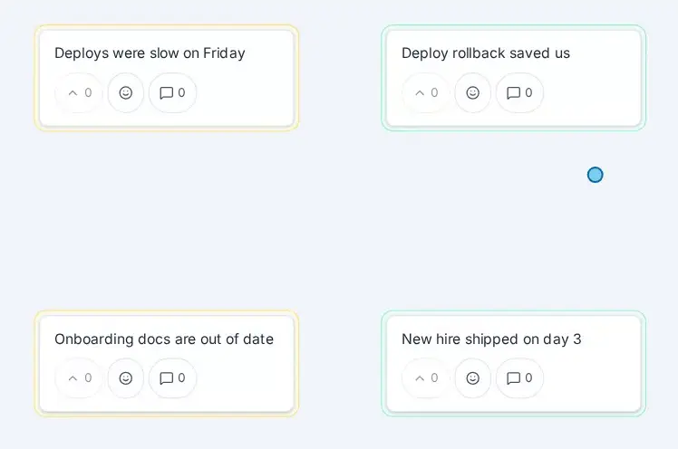

# User guide: use-case pages with short clips

Status: plan, awaiting decisions G1–G4 · checked against `main` at `b002576` · researched 2026-11-06

## Why

Scott dropped cards onto each other on a canvas in Group, expecting them to group or merge. On a canvas that only overlaps them, by design (`docs/canvas-mode-plan.md`). Rather than change that behavior, this plan makes the guide good enough to explain it: separate pages per use case, with clips of the actions.

**One limit to plan for.** The guide already says "Dropping a card on another card overlaps them and never merges them", and the phase bar already says "Drag cards near each other to cluster them". Neither prevented this, because nobody opens a guide in the middle of a drag. So better pages only help if the board links to them at the moment of confusion. PR 2 adds that link, and PR 1 adds a count of drops onto cards, so we can tell whether the guide was enough.

## Bottom line

- Replace the one long `/docs` page with **8 pages named after what someone is trying to do**, plus a landing page.
- Add about **10 clips, each under 10 seconds**, only where motion is the point. Everything else stays text.
- **Record clips with Playwright against the real app**, so they can be regenerated and CI notices when a flow they show breaks.
- Ship clips as **animated WebP**, not `.gif`. They behave like GIFs, are about a quarter of the size, and need no server change.
- Fix the guide's stale text in the same move. It's already wrong in several places.

## What competitors do

Sampled in November 2026. This covers the pages listed, not each vendor's whole help site.

| Product | Structure | Media on the pages sampled |
| --- | --- | --- |
| [Spreo](https://docs.spreo.io) (formerly Metro Retro) | Getting Started ([Running Your First Session](https://docs.spreo.io/getting-started/running-your-first-session)), one page per feature, FAQs, Keyboard Shortcuts | Annotated screenshots, no GIFs. Videos are separate, on [YouTube](https://www.youtube.com/watch?v=rJmKBFDWUek). |
| [TeamRetro](https://help.teamretro.com/article/152-retrospectives) | One page per retro step. [Group](https://help.teamretro.com/article/160-retrospective-group-step) covers who can group, drag and drop, and AI. | Screenshots plus 2 embedded YouTube videos on Group |
| [EasyRetro](https://intercom.help/easyretro/en/articles/12386250-easyretro-guidelines-start-the-right-way) | A "start the right way" checklist linking to one-task "How to…?" articles | Screenshots, no GIFs. Tutorials are on [YouTube](https://www.youtube.com/watch?v=Yl6wV7EIRBw). |
| [Team O'clock](https://www.teamoclock.com/help/the-retrospective-meeting) | One long walkthrough of a meeting | Screenshots plus **4 GIFs of single actions** (`set-timer.gif`, `retro-group-notes.gif`, and others). Closest to this plan. |
| [Parabol](https://www.parabol.co/resources/retrospective-meetings) | "Retrospective Meetings 101": one section per phase, with facilitator tips | Images, plus a [video walkthrough](https://www.youtube.com/watch?v=C96fNtypaww). `help.parabol.co` didn't resolve, so its help site isn't covered. |

**What to borrow:**

1. **Separate "run your first session" from feature reference.** Spreo, TeamRetro and EasyRetro all do. Our guide mixes them.
2. **Title pages by the task.** EasyRetro's "How to merge and unmerge the cards on your board?" is what someone actually searches for.
3. **Say who can do what.** TeamRetro's Group page opens with it. Our two role tabs hide that behind a toggle.
4. **Short clips of single actions**, as Team O'clock does. Most others use screenshots and send you to YouTube for motion, so a clip in the page, right beside the step, beats what most of them offer.

**Also relevant to the bug that started this:** dropping a card on a card means group or merge across this category. See [EasyRetro](https://www.youtube.com/watch?v=Yl6wV7EIRBw) ("just dragging one card on top of another"), [TeamRetro](https://help.teamretro.com/article/160-retrospective-group-step) ("drag and drop ideas to create groups"), and our own column boards. Expect Scott's assumption to be common, so the canvas page leads with it.

## Pages

| URL | Title | For | Covers |
| --- | --- | --- | --- |
| `/docs` | User guide | Everyone | "What are you trying to do?" cards. Replaces the role tabs. |
| `/docs/join` | Join a retro | Participants | The link, your name, what each phase asks of you, anonymous and hidden cards |
| `/docs/run` | Run your first retro | Hosts | Start, share, timer, next phase, end. The suggested 45-minute cadence stays here. |
| `/docs/group` | Group and merge cards | Everyone | Column boards: group across columns, rename, merge, ungroup, reorder, keyboard |
| `/docs/canvas` | Use a canvas board | Everyone | Opens with "Why don't cards merge when I drop them?". Then clustering, labels, pan and zoom, Top voted, List view, phones. |
| `/docs/brainstorm` | Run a private brainstorm | Hosts | Valentina's scenario: custom columns as problem statements, hide cards, timer, reveal, then group. Reuses the steps in `docs/qa-brainstorm-scenario.md`, in user terms. |
| `/docs/setup` | Set up and change a board | Hosts | Board types, Action items on or off, Edit board, inline rename |
| `/docs/save` | Save, export and start the next retro | Everyone | Board file, CSV, importing, exporting ended retros, archives, Start next retro |
| `/docs/reference` | Reference | Everyone | One table of phase × action × who, keyboard shortcuts, privacy facts |

Each page has the same shape: a one-line summary, a "For: hosts" tag, numbered steps, a clip beside the step it shows, then "Good to know". Previous and next links run through them in order, and a sidebar collapses to a menu on phones.

8 pages don't need search. Browser find works on each page and the landing cards cover discovery. Revisit if the guide grows.

## Clips

*A real sample, recorded for this plan against the build in prod.*

| Clip | Page | Shows |
| --- | --- | --- |
| `canvas-cluster` | canvas | Drag a card near another, add a label (the sample above) |
| `canvas-add` | canvas | Double-click to place a card, or use the composer |
| `canvas-navigate` | canvas | Pan, zoom, Fit |
| `group-across` | group | Drag a card onto one in another column, rename the group |
| `group-merge` | group | Merge a group into one card |
| `hide-reveal` | brainstorm | Placeholders during Brainstorm, then Group reveals them |
| `new-custom` | setup | Start a new retro → Custom → name columns |
| `edit-board` | setup | Add and reorder a column on a live board |
| `run-phases` | run | Start the timer, advance a phase |
| `save-import` | save | Save a board file, import it into a new board |

### Format

The sample clip (7.8 seconds, 748×496), measured:

| Format | Size | Needs |
| --- | --- | --- |
| **Animated WebP, 15 fps** | **184 KB** | ``. Works on today's server. |
| GIF, 12 fps, 128 colors | 815 KB | `` |
| MP4 (H.264), 24 fps | 70 KB | `<video>`, plus a server change |

**Use animated WebP.** MP4 is smaller, but [iOS requires byte-range requests](https://developer.apple.com/library/archive/documentation/AppleApplications/Reference/SafariWebContent/CreatingVideoforSafarioniPhone/CreatingVideoforSafarioniPhone.html) for video and our `static_handler` (`src/main.rs`) takes only the URI, so it can't honor them. That's new Rust in the path serving every asset, to save about 110 KB a clip. Real GIFs would add about 8 MB to a 10.7 MB binary, because `rust-embed` compiles assets in, where WebP adds about 2 MB. Animated WebP [works in all current browsers](https://css-tricks.com/gifs-without-the-gif-the-most-performant-image-and-video-options-right-now), and [MDN recommends it](https://developer.mozilla.org/en-US/docs/Web/Media/Guides/Formats/Image_types) for animated images. If we ever want long tutorials, add Range support then.

Not tested here: Safari and iOS. Our Playwright setup is Chromium-only, so Scott checks PR 2 on an iPhone during QA.

### Recording recipe

The sample took three takes, and these are the fixes it needed:

- **Seed with a board file** that sets card positions, so every take is identical.
- **Inject a visible cursor.** Headless recordings don't show the pointer, and a clip of a card moving by itself explains nothing.
- **Record a fresh session from saved storage state.** Recording in the same session that created the board showed a duplicate "Host (2)".
- **Zoom in and crop to the action.** At the default Fit zoom with the full header, card text was unreadable. Cropping also removes the "Imported from a file" chip, which isn't what a real board shows.
- **Hold the last frame about 1.5 seconds** so the result registers before the loop restarts.

### Accessibility

- Clips never carry information alone: the numbered step beside each clip says the same thing, and `alt` describes the action.
- Looping motion over 5 seconds [needs a way to pause](https://theadminbar.com/accessibility-weekly/should-you-use-animated-gifs) (WCAG 2.2.2), so every clip has a Pause button, operable by keyboard. An `` can't pause, so the button swaps `src` to a still poster.
- With `prefers-reduced-motion`, clips start on the poster with a Play button. `Board.svelte` already checks this setting for confetti.
- No flashing: these are screen recordings of the board UI.

## Stale text to fix

Found by comparing the guide with the UI at `b002576`. PR 1 fixes these, and each page is checked against the running app as it's written.

| Guide says | Actually |
| --- | --- |
| Click **Host a retro** and paste the lead token | No such button anywhere outside the guide |
| Click **New retro** | The button is **Start a new retro** |
| **Open as host** "in the header" | It only exists as a tooltip on the history page |
| "Authorship is shown on every card" | New boards are anonymous by default (`NewRetroModal.svelte`) |
| "The five phases" | A board without Action items has four |
| "Each session its own slug", for recurring retros | **Start next retro** does this now |
| "Lead" throughout | The UI says **Host** |

## Design

**Routing.** Nested SvelteKit routes under `frontend/src/routes/docs/`. No server change: `static_handler` already serves the SPA for any path without a dot, and `/docs/canvas` qualifies.

**Modules.**

| File | Job |
| --- | --- |
| `lib/guide/pages.ts` | The one list of pages: slug, title, summary, audience. Drives landing cards, sidebar and previous/next, so adding a page is one entry plus one route. |
| `routes/docs/+layout.svelte` | Header, sidebar, previous/next, and the prose styles moved out of today's page |
| `lib/guide/GuideClip.svelte` | Clip, poster, alt, caption, Pause and reduced-motion behavior, lazy loading |
| `lib/guide/clips/*.webp` | The committed clips |

**Authoring stays in Svelte.** Markdown via `mdsvex` would add a build dependency to save little, because these pages need components for clips anyway.

**Clips use Vite imports** (`import clip from '$lib/guide/clips/canvas-cluster.webp'`). A missing clip then fails the build, and the file gets a hashed name. There's no `frontend/static/` today, and no reason to add one. CSP needs no change: `img-src 'self'` covers them.

**Old links keep working.** `/docs?role=lead` redirects to `/docs/run` and `/docs?role=participant` to `/docs/join`. `Board.svelte` and `Onboarding.svelte` use those links today, `routes/+page.svelte` links plain `/docs`, and older copies may be in chat history. The app's own links move to the new pages.

**In-context help.** The Group hint on a canvas becomes "Drag cards near each other to cluster them. They never merge. Double-click to add a label." with a **How it works** link to `/docs/canvas`, opening in a new tab so nobody leaves the board. The link sits outside the hint's `truncate` span (`Board.svelte:820`), so narrow screens can't cut it off. Other phase hints get links only where a page answers a real question: start with this one.

**Analytics.** GA is on in prod. Add to `AnalyticsEvent`, using fixed enums only, as that file requires:

- `guide_view { page }`
- `guide_open { from: 'phase_hint' | 'footer' | 'onboarding' | 'home' }`
- `canvas_drop { on_card: boolean }`

`canvas_drop` is what answers whether the guide worked. If a large share of canvas drops still land on another card after this ships, the snap idea is worth revisiting.

## Keeping it from going stale

The current guide shows how this fails: seven wrong statements in a page nobody tests. So:

1. **Clip scripts are real flows.** They live in `tests/guide-clips/`, run through Playwright with its own config, and use the same helpers as the e2e specs. `make guide-clips` runs them on a scratch port (the `test-local.sh` pattern, never 5102 or 5103) and regenerates the files. `make guide-clips CLIP=canvas-cluster` does one.
2. **CI runs them without recording**, in the full `e2e` tier, so renaming a button a clip depends on fails CI instead of leaving a wrong clip behind. It doesn't catch a UI that merely looks different, so a visual change still needs a re-record.
3. **`tests/guide.spec.ts`** checks that every page in `pages.ts` loads, every clip decodes (`naturalWidth > 0`), the old `?role=` links redirect, Pause and reduced-motion work, and there are no CSP or console errors.
4. **A size check in CI's quick tier**: fail if any clip is over 300 KB or all of them over 3 MB. Repo history keeps every committed version, so re-record only the clips a change affects.
5. **A line in `tests/README.md`**: changed a flow? Update its guide page and clip.

ffmpeg is needed only to regenerate clips, not to build. CI's build uses the committed files.

## Rollout

Stacked PRs off `main`, each passing the usual gates (`cargo test`, `cargo clippy --all-targets`, `bun run check`, unit tests, `./test-local.sh`). Docs ship the normal way: QA first, and prod once QA holds `main`'s build (`docs/RELEASING.md`). No DB, schema or server change in any of them.

| PR | Scope | Useful alone? |
| --- | --- | --- |
| 0 | This plan | |
| 1 | Pages, `pages.ts`, layout, redirects, all text moved and corrected, `guide_view`, `canvas_drop`, `guide.spec.ts` | Yes: readable, correct guide with no clips |
| 2 | `GuideClip`, the clip pipeline and size check, the 3 canvas clips, the Group hint link, `guide_open` | Yes: answers the question that started this. Scott checks on an iPhone here. |
| 3 | The other 7 clips, and CI running clip scripts | Yes |

PR 2 is the riskiest, because of the recording pipeline and Safari. If WebP or the recipe disappoints there, we've spent little and PR 1 still stands.

**Done when:** Scott, or someone new to the app, can go from the Group hint on a canvas to an answer in one click, and `canvas_drop` starts reporting.

## Decisions for Scott

| | Question | Recommendation |
| --- | --- | --- |
| **G1** | Animated WebP, or true `.gif`? | **WebP.** Same behavior at a quarter of the size. A real GIF only helps pasting into chat, and we can export one for that when needed. |
| **G2** | Are these the right 8 pages? | **Yes.** `/docs/brainstorm` is the most debatable: it could be a section of `/docs/run`, but it's the one use case a real user asked for by name. |
| **G3** | Change the Group hint to say "They never merge", and link from it? | **Yes.** It's the only piece here that reaches someone mid-drag. |
| **G4** | Record clips in light mode only, or also dark? | **Light only**, with a border in dark mode. Two sets double the size and the re-recording. |

## Not in this plan

- **Snap on drop.** Parked in favor of the guide, as Scott asked. `canvas_drop` will say if it's worth revisiting.
- **Search**, **translations**, a **public changelog**.
- **Interactive walkthroughs or tooltips in the app.**
- **Pre-rendering for search engines.** Guide pages render client-side today (`ssr = false`), so crawlers see little. Worth doing only if we want the guide to bring people in.
- **Long-lived caching.** `static_handler` sends `no-cache` with no `ETag`, so assets re-download on each visit, clips included. Lazy loading limits this to clips actually scrolled to. A small fix for `_app/immutable/` would help the whole app, and is better as its own PR.
