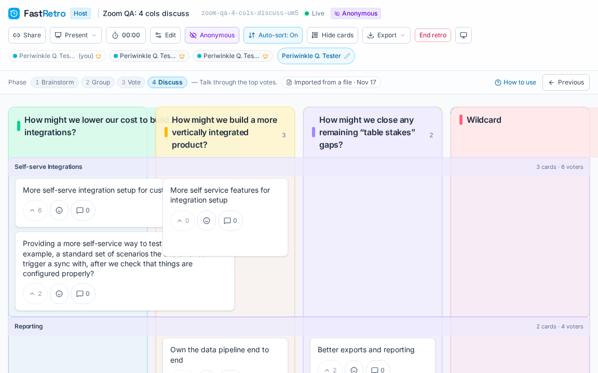

# Plan: board columns break when zoomed in

Status: proposed, root cause confirmed · 2026-11-17 · checked against `main` at `1b62d35` (the build on QA and prod)

## The bug

Scott's screen recording (prod, a 4-column board in Discuss with one group): at 100% and 110% browser zoom the board is fine. At 125%, 150% and 175%:

- the first column's title runs under the second column's title
- the column counts (11, 3, 5, 6) slide out of their headers
- grouped cards are wider than their column and overlap the next one
- the column tints stay at one width while the content on top is wider, so the colors no longer match the content
- the page scrolls sideways and the last column runs off the edge

*Reproduced locally at 125% zoom with an imported test board. The first column has a card containing a long URL.*

## Root cause

Zooming in makes the page narrower in CSS pixels (125% of a 1440px window is 1152px), so it's really "the board breaks below a certain width". Zoom is just how it showed up.

When groups are visible (Group, Vote, Discuss, on screens 768px and wider), each column is a `grid grid-rows-subgrid` section so its group cells line up with the other columns (`BoardColumn.svelte`, `alignedRows` in `clusters.ts`). That section sets its **rows** but never its **columns**, so it gets one implicit `auto` column track. An `auto` track never goes below the min-content width of what's inside it, so one long word anywhere in the column (a URL, an identifier) makes the column's content wider than the column itself:

| Measured at 1152px | Column 1 | Column 2 | Column 3 | Column 4 |
| --- | --- | --- | --- | --- |
| Section (outer grid track) | 268px | 268px | 268px | 268px |
| Inner track = header and card width | **447px** | 266px | 266px | **557px** |

Column 1 has a URL card and column 4 has an 80-character word. Adding `grid-template-columns: minmax(0, 1fr)` to the sections in the browser brought every inner track back to 266px and removed the sideways page scroll.

Card text uses `break-words` (`overflow-wrap: break-word`), which wraps a long word only when it's drawn, not when the width is worked out, so it doesn't help here. `overflow-wrap: anywhere` does.

Why it only showed up in Discuss: Brainstorm never shows groups, so it uses the plain flex layout, where columns are always the width of their grid track. The bug needs groups to be showing **and** a long word in a column that's too narrow for it. In Scott's board, the URL card fit at ~330px columns (100%) and didn't at ~268px (125%).

## QA sweep

I imported test boards into an isolated local copy of the `main` build (scratch port and DB, not QA or prod) and screenshotted every page at 8 sizes. Each check measured whether anything in a column poked out of it and whether the page scrolled sideways.

Sizes: 1440 (100%), 1309 (110%), 1152 (125%), 960 (150%), 823 (175%), 720 (200%) wide, tablet 768×1024 and phone 390×844.

| Page | Result |
| --- | --- |
| 4-column board, Group / Vote / Discuss, with groups and long words | ❌ Broken at **every** width from 768 up, including 100%, as soon as a long word is wider than its column. Fine below 768px (stacked layout). |
| 6-column board (wide, already scrolls sideways), Group, with groups | ❌ Same bug: column 1's cards are 176px wider than the column. |
| 4-column board, Brainstorm (no groups showing) | ✅ at all sizes |
| Classic 3-column board, Brainstorm | ✅ at all sizes |
| Present menu, Edit board dialog (over the Discuss board) | The menus are fine. The board behind them shows the same bug. |
| Home, Start a new retro dialog, host dashboard, user guide | ✅ at all sizes |
| Phone (390px) for all of the above | ✅ No sideways scroll. Columns stack, and long URLs wrap. |

Other things I noticed, which aren't bugs:

- **Narrow columns.** At 150% a 4-column board without groups gets 220px columns. It doesn't break, but it's cramped. The min-width change below fixes this.
- **Header uses a lot of height at high zoom.** From 175% up the host header wraps to three rows (toolbar, people, name) and takes about a quarter of a 514px-tall window. The phone menu (☰) only appears below 640px.

## Fix

Three PRs, smallest and most urgent first. PR 1 alone fixes the bug in the video.

### PR 1: columns never get wider than their track (the bug)

- `BoardColumn.svelte`: when `aligned`, add `grid-cols-1 min-w-0` to the section so its single column is `minmax(0, 1fr)` and can't grow past the outer track.
- Add `wrap-anywhere` to user text that can hold a long word: card text and comments (`Card.svelte`), column titles (`EditableHeading` as used by `BoardColumn`), group names (`ClusterHeader`), the board name and display names. This keeps a long URL inside its card instead of being clipped. `wrap-anywhere` is built into Tailwind 4.1+, and we're on 4.3.
- New e2e test `tests/layout.spec.ts`, run through `./test-local.sh` as usual:
  - Import a board file fixture (4 columns, two groups, a long-URL card and a long unbroken word) in Brainstorm, Group, Vote and Discuss.
  - At 1440, 1152, 960 and 768px wide, assert that nothing inside each column section sticks out of it, and that the page itself doesn't scroll sideways (the board's own scroller from PR 2 is allowed).
  - Run it once on the 6-column board too.
  - Leave the browser's "find what sticks out" check in a helper so PR 2 and PR 3 reuse it.

Risk: low. It's CSS-only and the aligned layout's row logic doesn't change. Ship it on its own: QA, then prod.

### PR 2: columns keep a minimum width and the board scrolls sideways

Scott's call: below a certain width, columns stop shrinking and the board scrolls sideways.

- `columns.ts` `boardGridClass`: on 768px and up, use one rule for every board: `repeat(var(--board-cols), minmax(17rem, 1fr))` in an `overflow-x-auto` container with scroll snap. 17rem is the minimum wide boards already use. Today boards with 5+ columns get this and boards with 2–4 get `minmax(0, 1fr)`. `isWideBoard` then only decides whether the board keeps the `max-w-7xl` cap.
- Only the board scrolls sideways. The header and phase bar stay put at full width.
- Group rows: the group name already sticks to the left edge on wide boards (`ClusterRow`, `wide`). Turn that on whenever the board actually overflows, not only for 5+ columns. A `ResizeObserver` on the scroller can set it.
- Make the scrolling obvious: a soft fade on the edge that has more columns, and a visible scrollbar on desktop.
- Moving cards to a column that's off screen:
  - Keyboard: after Shift+←/→ moves a card, call `scrollIntoView({ inline: 'nearest' })` on it.
  - Mouse: check that dragging a card to the edge scrolls the board in Chrome, Safari and Firefox. If one doesn't, add a small edge-scroll during `dragover`.
- Canvas boards' List view uses `ColumnsSurface` too, so it gets this for free. Check it in QA.
- Tests: extend `layout.spec.ts` to check that at 960px a 4-column board's columns are ≥272px wide, the board container scrolls sideways and the page doesn't. Also check that Shift+→ into an off-screen column brings the card into view.

### PR 3: phones (Scott said "ideally"; needs decision M1)

Today, below 768px every column stacks vertically. It works (no QA failures), but on a board with 4+ columns you scroll a long way to reach the last column, and you lose the sense of columns side by side.

**Recommendation: swipe between columns on phones.** Each column takes about 85% of the screen width (`min(85vw, 22rem)`) with the next one peeking in, plus scroll snap. Add a sticky strip of column chips at the top ("What went well · 4") to jump to any column. That's the same sideways model as PR 2, just one column at a time.

- Groups on phones stay as they are today: blocks inside each column. Aligned rows across columns don't make sense when you see one column at a time.
- Moving cards on touch already goes through the card menu and Shift+arrows (HTML5 drag doesn't work on most phones), so swiping doesn't take anything away.
- Keep the composer at the bottom of each column. After you add a card, the board stays on that column.
- Check the Present mode window and the reminder at phone size.

**M1 (Scott):** swipe columns as above, or keep the stacked layout and just add the column-chip strip to jump between columns? Swiping is more consistent with PR 2. Stacking is less work and lets you scroll through everything in one go.

### Optional, separate: a smaller header at high zoom

From 175% up, the host header takes three rows. We could show the ☰ menu below 1024px instead of 640px, or move the less-used host toggles (Anonymous, Auto-sort, Hide cards) into a "More" menu. This doesn't need to block the above. **M2 (Scott):** do it now, later, or never?

## Order and release

1. PR 1, then QA (the layout fixture at 100–175%; no real board data on QA, since it's public), then prod. That fixes the reported bug.
2. PR 2, stacked on PR 1.
3. PR 3 after M1 is decided.

Each PR follows `docs/RELEASING.md`. None of them changes the server or the board data, so rolling back is just redeploying the previous build.
